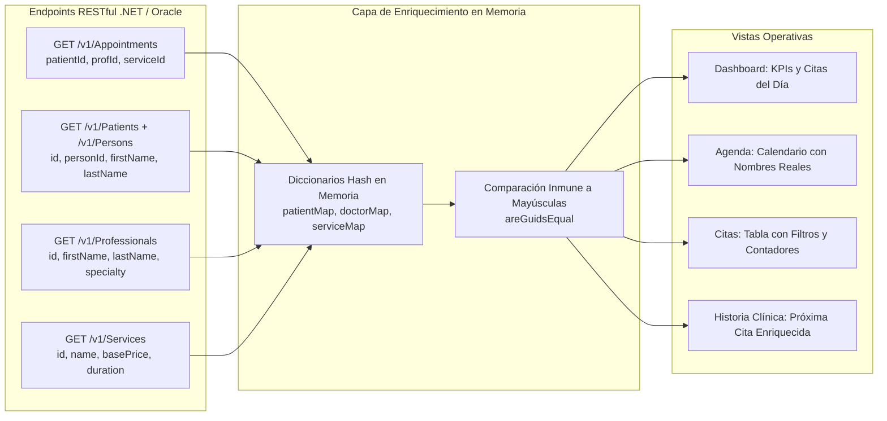

# 🏛️ Arquitectura del Sistema — NexusOdonto

> **Versión del Documento:** 5.1.0 (Definitiva y Actualizada)  
> **Estado:** Documentación Oficial de Referencia, Mapeo Estructural del Frontend y Guía de Sustentación Técnica  
> **Ecosistema Tecnológico:** React 19, TypeScript 5 (Strict Mode), Vite 8, Tailwind CSS v4, React Router 7, Axios, Lucide React, Google Fonts (`Playfair Display`, `Plus Jakarta Sans`)  
> **Backend & Persistencia:** ASP.NET Core 10 (.NET), Clean Architecture, Entity Framework Core, Oracle Database 21c (`XEPDB1`)  
> **Microservicio de IA & Chatbot:** Python, FastAPI, LangGraph, OpenAI (GPT-4o), Qdrant Vector DB, WebSockets / REST  
> **Última Actualización:** Septiembre 2026  

---

## 1. 🏗️ Visión General y Topología del Sistema

NexusOdonto es una plataforma clínica-odontológica de grado empresarial diseñada con una arquitectura desacoplada de tres capas: una **Single Page Application (SPA)** reactiva en el Frontend, una **API RESTful de Alta Concurrencia** en .NET y un **Motor Asistente de IA (RAG)** en FastAPI, todos respaldados por una base de datos relacional corporativa en **Oracle Database XE**.

```
┌──────────────────────────────────────────────────────────────────────────────────────────────────┐
│                             NEXUSODONTO FRONTEND (React 19 + Vite 8)                             │
│  • SPA basada en componentes funcionales con TypeScript Estricto.                                │
│  • Estado Global Ligero: AuthContext (Sesión, RBAC y JWT), ThemeContext, NotificationContext.    │
│  • Interceptores Axios: Inyección automática de Bearer Token y refresh silencioso.              │
│  • Capa de Enriquecimiento: Resolución en memoria de IDs UUID a Nombres Reales Clínicos.        │
│  • Seguridad en Enrutamiento: ProtectedRoute (RBAC por Roles) + PublicOnlyRoute.                 │
│  • Blindaje de Navegación: Control del historial popstate con { replace: true }.                 │
│  • Páginas de Error Editoriales: ErrorAccessPage (401/403) y NotFoundPage (404) con fondos.      │
│  • Módulo Asesor / Chatbot: AtencionAsesorView con gestión de tickets y mensajería en vivo.      │
│  • Asistente Flotante: ChatBotWidget inyectado en Layout con fallback contextual resiliente.     │
└────────────────────────────────┬─────────────────────────────────┬───────────────────────────────┘
                                 │ HTTP / REST JSON (Bearer JWT)   │ HTTP POST /chat (JSON)
                                 ▼                                 ▼
┌────────────────────────────────────────────────┐ ┌──────────────────────────────────────────────┐
│        BACKEND API PRINCIPAL (.NET 10)         │ │         MICROSERVICIO CHATBOT IA             │
│  • Arquitectura Limpia (Domain, App, Infra).   │ │  • FastAPI, LangGraph, Qdrant Vector DB.     │
│  • Autenticación JWT + Google OAuth2.          │ │  • RAG Clínico y Consulta de Disponibilidad. │
│  • EF Core con Proveedor Oracle Oficial.       │ │  • Gestión de Tickets y Escalamiento Humano. │
│  • Puerto: 5170                                │ │  • Puerto: 8000                              │
└───────────────────────┬────────────────────────┘ └──────────────────────────────────────────────┘
                        │ Conexión TCP/IP (Oracle Net Services)
                        ▼
┌──────────────────────────────────────────────────────────────────────────────────────────────────┐
│                              BASE DE DATOS ORACLE 21c (`XEPDB1`)                                 │
│  • Esquema Relacional Normalizado con Claves Primarias RAW(16) / GUIDs.                          │
│  • Tablas Principales: USERS, PERSONS, PATIENTS, PROFESSIONALS, APPOINTMENTS, SERVICES.         │
│  • Seguridad: USER_ROLES, ROLE_PERMISSIONS, ACTION_PERMISSIONS, USER_EXTERNAL_LOGINS.            │
└──────────────────────────────────────────────────────────────────────────────────────────────────┘
```

---

## 2. 📂 Inventario y Mapeo Estructural de Archivos (`src/`)

El frontend está organizado bajo el patrón **Feature-First / Domain-Driven Design (DDD)**, agrupando lógica, interfaces y componentes por dominio de negocio:

```
NexusOdontoFrontend/
├── ARCHITECTURE.md                  # Este documento maestro de arquitectura y sustentación
├── index.html                       # Documento raíz con inyección de fuentes Playfair Display y favicon SVG
├── package.json                     # Declaración de librerías y scripts de construcción
├── tsconfig.json                    # Reglas estrictas de compilación TypeScript (Strict Mode)
├── vite.config.ts                   # Configuración del bundler Vite y plugins de React
├── public/                          # Recursos Estáticos Servidos Directamente
│   ├── favicon.svg                  # Favicon vectorial cuadrado (1:1) de alta fidelidad
│   ├── favicon.webp                 # Isotipo cuadrado 1:1 transparente
│   ├── icons.svg                    # Sprites SVG de redes y utilidades
│   └── robots.txt                   # Instrucciones de indexación para motores de búsqueda
│
└── src/
    ├── api/                         # 🌐 Capa de Abstracción de Red (Service Layer)
    │   ├── axiosClient.ts           # Instancia central de Axios con interceptores JWT
    │   ├── authService.ts           # Endpoints de Login, Register, Google OAuth y Perfil
    │   ├── appointmentService.ts    # CRUD completo de citas médicas (/v1/Appointments)
    │   ├── patientService.ts        # Gestión de fichas de pacientes (/v1/Patients)
    │   ├── personService.ts         # Datos de identidad civil (/v1/Persons)
    │   ├── professionalService.ts   # Directorio de odontólogos y licencias (/v1/Professionals)
    │   ├── employeeService.ts      # Gestión de empleados clínicos y administrativos
    │   ├── specialtyService.ts      # Catálogo de especialidades odontológicas
    │   ├── sexService.ts            # Catálogo de sexos biológicos para historia clínica
    │   ├── serviceCatalogService.ts # Catálogo y precios de procedimientos (/v1/Services)
    │   ├── roleService.ts           # Catálogo de roles (/v1/Roles)
    │   ├── documentTypeService.ts   # Catálogo de tipos de documento (CC, TI, CE, Pasaporte)
    │   ├── userService.ts           # Gestión de usuarios y estados (/v1/Users)
    │   └── chatbotService.ts        # Comunicación con el microservicio RAG en Python y gestión de tickets
    │
    ├── assets/                      # 🖼️ Recursos Multimedia Optimizados (WebP)
    │   ├── nexus-odonto-logo.webp   # Isotipo oficial transparente de la clínica
    │   ├── fondoLogin.webp          # Fondo visual modo oscuro para autenticación
    │   ├── fondo-Login-ligh.webp    # Fondo visual modo claro para autenticación
    │   ├── fondo-darck.webp         # Fondo para el Dashboard en modo oscuro
    │   ├── fondo-ligh.webp          # Fondo para el Dashboard en modo claro
    │   ├── landingfondo-black.webp  # Fondo landing page oscuro
    │   ├── landingfondo-white.webp  # Fondo landing page claro
    │   ├── error_403_darck.webp     # Fondo modo oscuro para vistas 401 y 403
    │   ├── error_403_light.webp     # Fondo modo claro para vistas 401 y 403
    │   ├── error_404_darck.webp     # Fondo modo oscuro para vista 404
    │   └── error_404_light.webp     # Fondo modo claro para vista 404
    │
    ├── components/                  # 🧩 Componentes Reutilizables Transversales
    │   ├── common/                  # Componentes atómicos de UI
    │   │   ├── BrandLogo.tsx        # Isotipo + tipografía adaptativa Light/Dark en tiempo real
    │   │   ├── UserAvatar.tsx       # Avatar resiliente con soporte Base64 e iniciales dinámicas
    │   │   ├── ThemeToggle.tsx      # Selector de tema Dark / Light
    │   │   ├── SelectOrWriteInput.tsx # Selector dual inteligente (filtrado dinámico o texto libre)
    │   │   ├── ErrorBoundary.tsx    # Capturador de excepciones React en tiempo de renderizado
    │   │   └── Modal.tsx            # Contenedor modal con animación y foco accesible
    │   ├── layout/                  # Componentes estructurales del cascarón
    │   │   ├── PageHeader.tsx       # Barra superior con avatar, tema y bienvenida personalizada
    │   │   ├── Sidebar.tsx          # Menú lateral reactivo filtrado por permisos RBAC con modo colapsable
    │   │   └── UserProfileDropdown.tsx # Dropdown de perfil de usuario con logout seguro
    │   └── chatbot/                 # Módulo de Inteligencia Artificial
    │       └── ChatBotWidget.tsx    # Botón flotante FAB y ventana de chat con asistente RAG
    │
    ├── context/                     # 🌐 Proveedores de Estado Global (Context API)
    │   ├── AuthContext.tsx          # Gestión de sesión, tokens JWT, roles y auto-sincronización
    │   ├── ThemeContext.tsx         # Gestión del tema visual persistido en localStorage
    │   └── NotificationContext.tsx  # Sistema global de notificaciones toast y recordatorios
    │
    ├── features/                    # 💼 Módulos de Negocio (Dominios Funcionales)
    │   ├── landing/                 # Pantalla de Bienvenida Pública
    │   │   └── LandingPage.tsx      # Portada animada con accesos directos y presentación clínica
    │   ├── auth/                    # Autenticación, Onboarding y Errores de Acceso
    │   │   ├── LoginPage.tsx        # Formulario de inicio de sesión tradicional y botón Google
    │   │   ├── RegisterPage.tsx     # Registro de nuevos pacientes (tradicional y onboarding Google)
    │   │   ├── AuthCallback.tsx     # Receptor y sanitizador de tokens de Google OAuth
    │   │   ├── ErrorAccessPage.tsx  # Pantalla editorial inmersiva para errores 401 y 403
    │   │   └── components/          # Inputs y botones estilizados de autenticación
    │   ├── dashboard/               # Métricas e Información en Tiempo Real
    │   │   └── DashboardPage.tsx    # KPIs operativos, citas enriquecidas y accesos rápidos por rol
    │   ├── pacientes/               # Directorio y Ficha Clínica de Pacientes
    │   │   ├── PacientesView.tsx    # Listado unificado (Oracle Persons + Patients + Local Cache)
    │   │   ├── components/PacienteForm.tsx # Modal de registro de pacientes en base de datos
    │   │   └── PacienteRegistroView.tsx # Formulario extendido de historia clínica y antecedentes
    │   ├── citas/                   # Agenda y Ciclo de Vida de Citas
    │   │   ├── CitasView.tsx        # Gestión de citas, enriquecimiento de IDs, modal controlado y contadores
    │   │   ├── components/CitasTable.tsx # Tabla interactiva con badges de estado y acciones
    │   │   └── types.ts             # Definición de interfaces TypeScript (Cita, EstadoCita)
    │   ├── agenda/                  # Vista de Calendario Clínico
    │   │   ├── AgendaView.tsx       # Matriz horaria con nombres reales de pacientes y doctores
    │   │   └── AgendaData.tsx       # Estructuras de datos de turnos y bloques horarios
    │   ├── chat-asesor/             # Centro de Atención y Escalamiento con Asesor
    │   │   └── AtencionAsesorView.tsx # Gestión de conversaciones WhatsApp/Web, tickets y respuestas
    │   ├── servicios/               # Catálogo de Procedimientos Odontológicos
    │   │   ├── ServiciosView.tsx    # Tarifas, tiempos y traductor de categorías/descripciones
    │   │   └── ServicioRegistroView.tsx # Formulario de creación de nuevos servicios
    │   ├── profesionales/           # Gestión de Personal Médico
    │   │   └── ProfesionalesView.tsx# Odontólogos, números de licencia y especialidades
    │   ├── usuarios/                # Seguridad y Cuentas de Acceso
    │   │   ├── UsuariosView.tsx     # Lista de usuarios, toggle de activación y roles en español
    │   │   └── components/UsuariosTable.tsx # Tabla interactiva con prevención de auto-desactivación
    │   ├── roles/                   # Control de Acceso Basado en Roles (RBAC)
    │   │   └── RolesPermisosView.tsx# Matriz interactiva de permisos y traducciones al español
    │   ├── historia-clinica/        # Expediente Clínico Digital
    │   │   └── HistoriaClinicaView.tsx # Evolución clínica con enriquecimiento de citas y diagnósticos
    │   ├── odontograma/             # Odontograma Gráfico Interactivo
    │   │   ├── OdontogramaUI.tsx    # Interfaz completa del odontograma anatómico
    │   │   └── components/          # Superficies dentales, cuadrículas y convenciones
    │   ├── configuracion/           # Parámetros del Sistema
    │   │   └── ConfiguracionView.tsx# Configuración general y ajustes de la clínica
    │   └── perfil/                  # Configuración de Cuenta de Usuario
    │       └── PerfilView.tsx       # Actualización de datos personales y valores por defecto para admin
    │
    ├── pages/                       # 📄 Páginas de Nivel Superior
    │   └── NotFoundPage.tsx         # Pantalla editorial inmersiva para error 404 (Not Found)
    │
    ├── layouts/                     # 📐 Plantillas de Envoltura (Layout Templates)
    │   └── DashboardLayout.tsx      # Cascarón privado: Sidebar + Header + Chatbot + Blindaje popstate
    │
    ├── routes/                      # 🚦 Enrutamiento y Guardias de Seguridad
    │   ├── index.tsx                # Definición de rutas declarativas con carga perezosa (React.lazy)
    │   ├── ProtectedRoute.tsx       # Guardia RBAC: bloqueo de rutas no autorizadas por rol
    │   └── PublicOnlyRoute.tsx      # Guardia de no-autenticados: impide volver a login si hay sesión
    │
    ├── utils/                       # 🛠️ Utilidades y Helpers
    │   ├── routePermissions.ts      # Matriz RBAC de permisos por ruta y extractor de roles
    │   ├── roleUtils.ts             # Normalizador de nombres de rol y comparador seguro `areGuidsEqual`
    │   └── currency.ts              # Formateador de moneda colombiana (COP)
    │
    ├── index.css                    # Directivas de Tailwind CSS v4, tema y fuentes corporativas
    └── main.tsx                     # Punto de entrada de inicialización de la SPA en el DOM
```

---

## 3. 🧠 Pipeline de Enriquecimiento y Consistencia de Datos

### 3.1 Cruce de Identificadores (UUIDs) a Datos Clínicos Reales
El backend entrega entidades desacopladas (ej. `GET /api/v1/Appointments` retorna únicamente `patientId`, `professionalId`, `serviceId`). Para evitar textos ficticios o genéricos (*"Paciente Registrado"*, *"Dr. Especialista"*):



### 3.2 Modal "Nueva Cita Directa" y Control de Estado Temporal
* **Vinculación React Controlada:** Sincronización estricta de `formHora` y `formFecha` evitando desfases con el DOM.
* **Normalización de Horas:** Soporte integral para entradas `12h` (AM/PM) transformadas a formato estándar `24h` (`HH:mm`).
* **Validación Temporal Estricta:** Bloqueo reactivo e informativo en caso de intentar agendar citas en fechas u horas pasadas.

### 3.3 Gestión de Usuarios y Prevención de Auto-Bloqueo
* **Toggle de Estado:** `userService.update(id, { isActive: boolean })` actualiza el estado operativo.
* **Auto-Lockout Guard:** Comprueba mediante `areGuidsEqual` y comparación de correos que el usuario en sesión no pueda auto-desactivarse.

---

## 4. 🌐 Estandarización de Idioma (I18n / Localización al Español)

Para mantener uniformidad cuando el backend entrega catálogos con cadenas en inglés:
* **Servicios (`ServiciosView.tsx`):** Transformadores `translateCategory` y `translateDescription` traducen términos como *"prophylaxis"*, *"whitening"*, *"assessment"* a español profesional.
* **Roles (`RolesPermisosView.tsx` y `UsuariosTable.tsx`):** Mapeo de roles (*Administrator $\rightarrow$ Administrador del Sistema*, *Doctor $\rightarrow$ Odontólogo Especialista*, *Receptionist $\rightarrow$ Recepcionista / Admisiones*).

---

## 5. 🗄️ Diccionario de Integración: Frontend ↔ Endpoints ↔ Tablas de Oracle

| Componente / Vista (Frontend) | Acción del Usuario | Endpoint Consumido (Backend .NET / Python) | Tablas Consultadas / Afectadas en Oracle (`XEPDB1`) | Campos Clave y Relaciones |
| :--- | :--- | :--- | :--- | :--- |
| **`LoginPage.tsx`** | Login con credenciales | `POST /api/auth/login` | `USERS`<br>`PERSONS`<br>`USER_ROLES`<br>`ROLES` | `USERS.ID`, `USERS.PERSON_ID = PERSONS.ID`, `USERS.PASSWORD_HASH`, `USER_ROLES.ROLE_ID = ROLES.ID` |
| **`RegisterPage.tsx`** | Registro tradicional | `POST /api/auth/register` | `PERSONS`<br>`USERS`<br>`USER_ROLES` | `PERSONS.DOCUMENT_NUMBER`, `PERSONS.EMAIL`, `USERS.PERSON_ID`, `USER_ROLES.ROLE_ID` (`PACIENTE`) |
| **`PacientesView.tsx`** | Listar directorio clínico | `GET /api/v1/Persons`<br>`GET /api/v1/Patients` | `PERSONS`<br>`PATIENTS`<br>`DOCUMENT_TYPES`<br>`SEXES` | `PATIENTS.PERSON_ID = PERSONS.ID`, `PERSONS.DOCUMENT_TYPE_ID = DOCUMENT_TYPES.ID`, `PERSONS.FIRST_NAME`, `PERSONS.PHONE` |
| **`CitasView.tsx`** | Listar citas médicas | `GET /api/v1/Appointments` | `APPOINTMENTS`<br>`PATIENTS`<br>`PERSONS`<br>`PROFESSIONALS`<br>`SERVICES`<br>`APPOINTMENT_STATUSES` | `APPOINTMENTS.PATIENT_ID = PATIENTS.ID`, `PATIENTS.PERSON_ID = PERSONS.ID`, `APPOINTMENTS.PROFESSIONAL_ID = PROFESSIONALS.ID`, `APPOINTMENTS.SERVICE_ID = SERVICES.ID` |
| **`CitasView.tsx`** | Agendar nueva cita | `POST /api/v1/Appointments` | `APPOINTMENTS` | `ID` (GUID), `PATIENT_ID`, `PROFESSIONAL_ID`, `SERVICE_ID`, `APPOINTMENT_STATUS_ID`, `STARTS_AT`, `ENDS_AT`, `REASON_FOR_VISIT` |
| **`CitasView.tsx`** | Modificar / Eliminar cita | `PUT /api/v1/Appointments/{id}`<br>`DELETE /api/v1/Appointments/{id}` | `APPOINTMENTS` | Actualización de horarios y estados o eliminación de registros |
| **`UsuariosView.tsx`** | Activar / Desactivar usuario | `PUT /api/v1/Users/{id}` | `USERS` | `USERS.IS_ACTIVE` (1 / 0) |
| **`AtencionAsesorView.tsx`** | Gestión de tickets y chat | `GET/POST /api/v1/Chatbot/tickets`<br>`POST /api/v1/Chatbot/messages` | Microservicio Python / Tablas de Tickets | Consulta y respuesta directa a mensajes de usuarios escalados desde WhatsApp |
| **`ChatBotWidget.tsx`** | Asistente RAG con IA | `POST http://localhost:8000/chat` | FastAPI ↔ .NET ↔ Oracle | Consulta semántica en Qdrant + disponibilidad en `APPOINTMENTS` |

---

## 6. 🚀 Comandos de Construcción y Verificación

```powershell
# 1. Comprobación estricta de tipos TypeScript (0 errores)
npx tsc --noEmit

# 2. Compilación de producción (Vite Bundler optimizado)
npm run build

# 3. Servidor de desarrollo local
npm run dev
```
