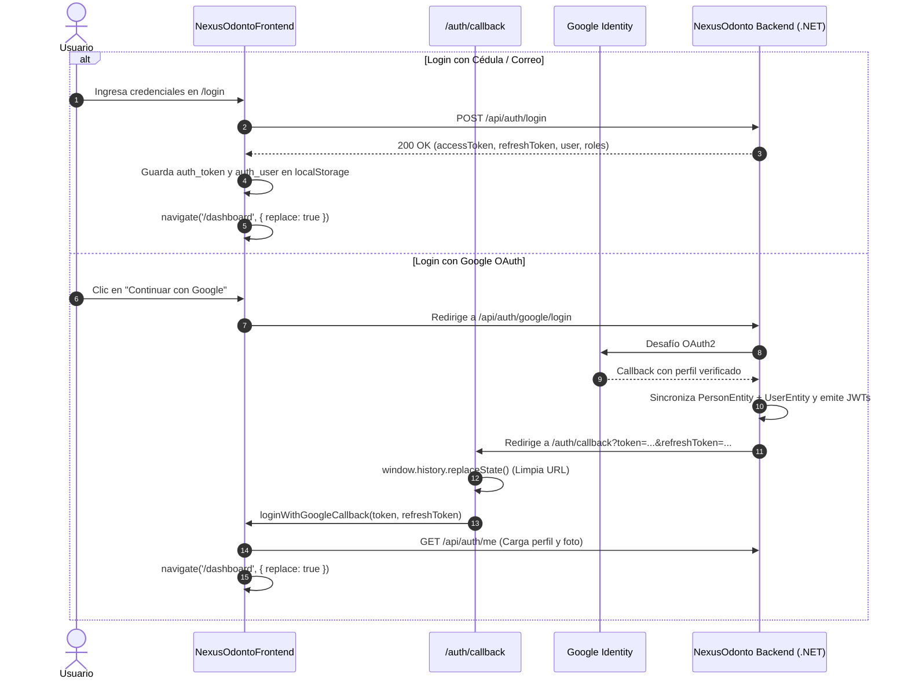
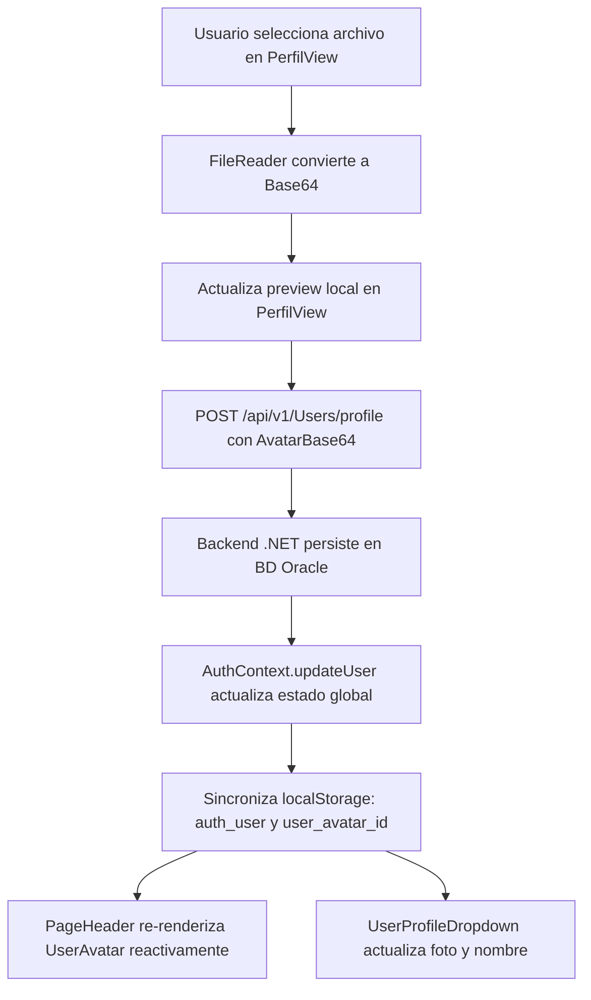

# 🏛️ Arquitectura del Sistema Frontend — NexusOdonto

> **Versión del Documento:** 3.0.0  
> **Estado:** Documentación Oficial de Referencia y Guía de Sustentación Técnica  
> **Tecnologías:** React 19, TypeScript (Strict Mode), Vite 8, Tailwind CSS v4, React Router, Lucide React, Axios  
> **Última Actualización:** Septiembre 2026  

---

## 1. 🏗️ Visión General y Stack Tecnológico

NexusOdonto Frontend es una **Single Page Application (SPA)** de grado empresarial diseñada bajo principios de alta cohesión, bajo acoplamiento y arquitectura orientada a características (**Feature-Driven Architecture**). Proporciona una interfaz clínica y administrativa reactiva, rápida y accesible para odontólogos, recepcionistas, administradores y pacientes.

```
┌──────────────────────────────────────────────────────────────────────────────────┐
│                      NEXUSODONTO FRONTEND (Arquitectura SPA)                     │
│  React 19 + TypeScript (Strict) + Vite 8.x + Tailwind CSS v4 + Lucide React     │
│  • Context API: AuthContext (RBAC y Tokens) / ThemeContext / NotificationContext │
│  • Interceptores Axios: Inyección Bearer JWT + Renovación Silenciosa             │
│  • Sistema de Enrutamiento: ProtectedRoute (RBAC) + PublicOnlyRoute              │
│  • Historial Blindado: Control de popstate y { replace: true }                   │
│  • Asistente Clínico Flotante: ChatBotWidget conectado a Microservicio AI        │
└───────────────────────┬──────────────────────────────────┬───────────────────────┘
                        │ HTTP / REST JSON (JWT)           │ HTTP POST /chat
                        ▼                                  ▼
┌──────────────────────────────────────┐ ┌─────────────────────────────────────────┐
│     BACKEND API PRINCIPAL (.NET)     │ │        MICROSERVICIO CHATBOT AI         │
│  Controllers RESTful, Clean Arch,    │ │  FastAPI, LangGraph, OpenAI (GPT-4o),   │
│  JWT Bearer Auth, Oracle EF Core     │ │  Qdrant Vector DB, PostgreSQL Memory    │
│  Puerto: 5170                        │ │  Puerto: 8000                           │
└──────────────────────────────────────┘ └─────────────────────────────────────────┘
```

### 1.1 Decisiones del Stack Tecnológico

| Herramienta / Librería | Versión | Justificación Arquitectónica |
| :--- | :---: | :--- |
| **React** | `19.x` | Renderizado eficiente mediante Virtual DOM, Server Components ready, concurrencia nativa y arquitectura declarativa orientada a componentes. |
| **TypeScript** | `5.x` | Tipado estricto en tiempo de compilación. Elimina errores de runtime en contratos DTO, interfaces de usuario y firmas de métodos. |
| **Vite** | `8.x` | Bundler y servidor de desarrollo basado en ESM nativo y Rollup. Tiempos de compilación ultrarrápidos (<1.5s en build de producción). |
| **Tailwind CSS** | `v4` | Sistema de diseño atómico basado en tokens CSS centralizados (`:root` / `@theme`). Cero sobrecarga de CSS no utilizado y diseño responsive nativo. |
| **React Router** | `v6 / v7` | Enrutamiento del lado del cliente (Client-Side Routing) con soporte de rutas anidadas, carga perezosa (`React.lazy`) y guards de seguridad. |
| **Context API** | Nativo | Gestión de estado global ligero para autenticación, tema y notificaciones. Evita el *boilerplate* excesivo y sobrepeso de librerías como Redux. |
| **Axios** | `1.7+` | Cliente HTTP modular con interceptores de petición y respuesta, configuración centralizada de timeouts y tipado genérico en DTOs. |
| **Lucide React** | `0.4+` | Iconografía vectorial SVG escalable y consistente. Estándar institucional de **cero emojis** en interfaces clínicas. |

---

## 2. 📂 Estructura de Directorios y Arquitectura de Carpetas

El proyecto adopta un enfoque **Feature-First / Domain-Driven**, organizando el código por módulos de negocio funcionales en lugar de agrupar todos los archivos por tipo:

```
NexusOdontoFrontend/
├── ARCHITECTURE.md                  # Este documento maestro de arquitectura
├── index.html                       # HTML base de entrada de la SPA
├── package.json                     # Dependencias y scripts de construcción
├── tsconfig.json                    # Reglas estrictas del compilador TypeScript
├── vite.config.ts                   # Configuración del bundler Vite
└── src/
    ├── api/                         # Capa de Abstracción de Red (API Services)
    │   ├── axiosClient.ts           # Instancia central de Axios con interceptores JWT
    │   ├── authService.ts           # Servicios de Login, Register, Google OAuth y Perfil
    │   ├── chatbotService.ts        # Cliente de integración con el microservicio AI
    │   ├── patientService.ts        # Directorio y admisión de pacientes (/v1/Patients)
    │   ├── personService.ts         # Datos de identidad humana (/v1/Persons)
    │   ├── roleService.ts           # Catálogo de roles (/v1/Roles)
    │   ├── documentTypeService.ts   # Catálogo de tipos de documento de identidad
    │   └── sexService.ts            # Catálogo de géneros/sexos
    │
    ├── assets/                      # Recursos multimedia estáticos optimizados (WebP)
    │   ├── nexus-odonto-logo.webp   # Isotipo oficial de la clínica
    │   ├── fondoLogin.webp          # Fondo visual modo oscuro para autenticación
    │   ├── fondo-Login-ligh.webp    # Fondo visual modo claro para autenticación
    │   ├── fondo-darck.webp         # Fondo para el Dashboard en modo oscuro
    │   └── fondo-ligh.webp          # Fondo para el Dashboard en modo claro
    │
    ├── components/                  # Componentes de UI Reutilizables y Transversales
    │   ├── common/                  # Componentes base
    │   │   ├── UserAvatar.tsx       # Avatar resiliente con iniciales automáticas
    │   │   ├── ThemeToggle.tsx      # Selector de tema Dark / Light
    │   │   └── Modal.tsx            # Contenedor modal accesible con animación
    │   ├── layout/                  # Estructura del cascarón de la aplicación
    │   │   ├── PageHeader.tsx       # Barra superior con avatar, tema y bienvenida
    │   │   ├── Sidebar.tsx          # Menú de navegación lateral filtrado por RBAC
    │   │   └── UserProfileDropdown.tsx # Dropdown de usuario con opción de logout
    │   └── chatbot/                 # Módulo del Asistente Virtual
    │       └── ChatBotWidget.tsx    # FAB flotante y ventana modal interactiva
    │
    ├── context/                     # Proveedores de Estado Global (Context API)
    │   ├── ThemeContext.tsx         # Gestión del tema visual (Claro / Oscuro)
    │   └── NotificationContext.tsx  # Sistema de notificaciones toast flotantes
    │
    ├── features/                    # Dominios de Negocio (Módulos Funcionales)
    │   ├── auth/                    # Autenticación, Registro y Callback OAuth
    │   │   ├── AuthCallback.tsx     # Receptor y sanitizador de tokens de Google
    │   │   ├── AuthContext.tsx      # Proveedor de sesión, usuario activo y tokens
    │   │   ├── LoginPage.tsx        # Pantalla de bienvenida e inicio de sesión
    │   │   ├── RegisterPage.tsx     # Pantalla de registro de nuevos pacientes
    │   │   ├── components/          # Inputs, botones y componentes específicos de Auth
    │   │   └── mocks/users.mock.ts  # Fallback de autenticación offline para desarrollo
    │   ├── dashboard/               # Métricas y accesos rápidos según el rol
    │   │   └── DashboardPage.tsx
    │   ├── citas/                   # Agendamiento y ciclo de vida de citas médicas
    │   │   ├── CitasView.tsx        # Vista principal con pestañas y modales
    │   │   └── components/CitasTable.tsx
    │   ├── pacientes/               # Directorio clínico y registro de pacientes
    │   │   ├── PacientesView.tsx
    │   │   └── PacienteRegistroView.tsx
    │   ├── odontograma/             # Odontograma clínico interactivo
    │   │   └── OdontogramaUI.tsx    # Piezas dentales, caras y patologías
    │   ├── servicios/               # Tarifas y catálogo de procedimientos
    │   │   └── ServiciosView.tsx
    │   ├── usuarios/                # Gestión de personal médico y administrativo
    │   │   └── UsuariosView.tsx
    │   └── perfil/                  # Configuración de cuenta y subida de avatar
    │       └── PerfilView.tsx
    │
    ├── layouts/                     # Plantillas estructurales de vistas
    │   └── DashboardLayout.tsx      # Layout con Sidebar, Header, Chatbot y bloqueo popstate
    │
    ├── routes/                      # Definición y Guardias de Enrutamiento
    │   ├── index.tsx                # Tabla de rutas con carga perezosa (React.lazy)
    │   ├── ProtectedRoute.tsx       # Guard de autorización RBAC y bloqueo de no autenticados
    │   └── PublicOnlyRoute.tsx      # Guard para impedir acceso a Login si ya hay sesión activa
    │
    ├── utils/                       # Utilidades, formateadores y reglas transversales
    │   ├── roleUtils.ts             # Traductor de GUIDs de roles a etiquetas amigables
    │   └── routePermissions.ts      # Matriz de permisos RBAC por ruta y helpers de rol
    │
    ├── index.css                    # Tokens de diseño, estilos globales y Tailwind CSS v4
    └── main.tsx                     # Punto de entrada de inicialización de la SPA React
```

---

## 3. 🔐 Mecanismo de Autenticación, Tokens y Seguridad en el Enrutamiento

### 3.1 Flujo de Autenticación Híbrido (Credenciales + Google OAuth)



### 3.2 Guardias de Enrutamiento (Route Guards)

La protección de rutas se implementa mediante dos componentes de orden superior basados en `<Outlet />`:

#### A. `ProtectedRoute.tsx` (Acceso Restringido a Usuarios Autenticados con RBAC)
1. **Validación de Carga (`isLoading`):** Si la aplicación está verificando la validez del token en `localStorage`, renderiza un estado de carga suave para evitar parpadeos visuales.
2. **Validación de Identidad:** Si `!isAuthenticated`, redirige inmediatamente a `/login` con `state={{ from: location.pathname }}` y `{ replace: true }`.
3. **Validación RBAC (`hasRouteAccess`):** Si el usuario no posee el rol o los permisos requeridos para la ruta específica (ej. un paciente intentando entrar a `/usuarios`), bloquea el acceso y renderiza la pantalla de **Acceso Restringido** con botón de retorno seguro a su `/dashboard`.

#### B. `PublicOnlyRoute.tsx` (Exclusivo para No Autenticados)
* Si un usuario con sesión activa intenta escribir manualmente en el navegador `http://localhost:5174/login` o `/register`, este guard intercepta la petición y redirige automáticamente a `/dashboard` con `replace: true`, impidiendo reingresar a los formularios de acceso.

### 3.3 Blindaje contra el Botón "Atrás" del Navegador (`popstate` y `{ replace: true }`)

Para resolver el problema común en las SPAs donde el usuario presiona la flecha "Atrás" en el navegador y es devuelto a la pantalla de Login o a la pantalla de selección de cuentas de Google:

1. **Reemplazo de Entrada en el Historial (`{ replace: true }`):**
   Tanto en `LoginPage.tsx`, `AuthCallback.tsx` como en el cierre de sesión (`logout`), las navegaciones utilizan `{ replace: true }`, sobrescribiendo la URL actual en la pila de navegación en lugar de apilar una nueva.
2. **Captura del Evento `popstate`:**
   En `DashboardLayout.tsx` y `ProtectedRoute.tsx` se registra un listener de ventana:
   ```typescript
   useEffect(() => {
     if (!isAuthenticated) return;
     window.history.pushState(null, '', window.location.href);

     const handlePopState = () => {
       // Si el usuario intenta retroceder con el navegador, anclarlo en la vista actual
       window.history.pushState(null, '', window.location.href);
     };

     window.addEventListener('popstate', handlePopState);
     return () => window.removeEventListener('popstate', handlePopState);
   }, [isAuthenticated]);
   ```
3. **Resultado:** La única forma posible de abandonar el área privada y regresar a `/login` es mediante la acción explícita del botón **"Cerrar Sesión"**.

---

## 4. 🔄 Flujo de Datos, Sincronización y Persistencia (Caso Avatar / Perfil)



### 4.1 Ciclo de Vida del Avatar de Usuario
1. **Conversión Asíncrona:** Al subir una imagen, `FileReader.readAsDataURL(file)` genera un string codificado en Base64 (`data:image/png;base64,...`).
2. **Persistencia Backend:** El string se envía al endpoint de perfil de la API .NET y se almacena en la entidad de usuario en la base de datos Oracle.
3. **Propagación en Estado Global:** Al recibir respuesta exitosa, `AuthContext.updateUser({ avatar: base64 })` actualiza el objeto `user` en memoria y sincroniza `localStorage.setItem('auth_user', ...)`.
4. **Renderizado Resiliente con Fallback ([`UserAvatar.tsx`](file:///C:/Users/ESSA7/OneDrive/Documentos/frontNexusOdonto/NexusOdontoFrontend/src/components/common/UserAvatar.tsx)):**
   - Si existe URL o Base64 válido, se renderiza la imagen.
   - Si la imagen falla al cargar (`onError`) o el usuario no tiene foto, el componente calcula automáticamente las iniciales del nombre y apellido (ej. *Carlos Administrador* $\rightarrow$ `CA`) sobre un gradiente de color corporativo, asegurando que **nunca se muestre una imagen rota**.

---

## 5. 🤖 Integración del Microservicio de Chatbot AI

El Frontend integra un **Asistente Virtual Inteligente** con capacidades de RAG y procesamiento de lenguaje natural conectado con el microservicio en Python/FastAPI (`NexusOdonto_ChatBot_AI-develop`):

```
┌───────────────────────────────┐                  ┌─────────────────────────────────┐
│     NexusOdontoFrontend       │                  │  NexusOdonto_ChatBot_AI-develop │
│  (React 19 / DashboardLayout) │                  │  (FastAPI / LangGraph / Docker) │
│                               │                  │                                 │
│  ChatBotWidget.tsx            │                  │  app/api/routes/chat.py         │
│  ├── FAB Flotante             │  HTTP POST /chat │  ├── LangGraph StateGraph       │
│  ├── Sugerencias por Rol      ├─────────────────►│  ├── OpenAI GPT-4o / RAG       │
│  └── chatbotService.ts        │  JSON Payload    │  └── Qdrant Semantic Cache      │
│                               │                  │                                 │
│  ◄── Fallback Contextual ──── │                  │  Puerto: 8000                   │
└───────────────────────────────┘                  └─────────────────────────────────┘
```

### 5.1 Estructura del Payload de Comunicación
El servicio [`chatbotService.ts`](file:///C:/Users/ESSA7/OneDrive/Documentos/frontNexusOdonto/NexusOdontoFrontend/src/api/chatbotService.ts) realiza peticiones asíncronas con la siguiente estructura:

```json
{
  "message": "¿Cómo solicito una cita de valoración?",
  "userId": "13000000-0000-0000-0000-000000000005",
  "role": "PACIENTE",
  "context": "nexus_odonto",
  "conversationId": "conv-uuid-12345"
}
```

### 5.2 Desacoplamiento e Inyección Global
* **Ubicación Arquitectónica:** El componente `ChatBotWidget` se encuentra inyectado directamente en [`DashboardLayout.tsx`](file:///C:/Users/ESSA7/OneDrive/Documentos/frontNexusOdonto/NexusOdontoFrontend/src/layouts/DashboardLayout.tsx), lo que garantiza que esté disponible de manera transversal en todas las pantallas protegidas (`/dashboard`, `/citas`, `/pacientes`, `/perfil`) sin necesidad de duplicar código en cada vista.
* **Tolerancia a Fallos (*Graceful Fallback*):** Si el microservicio de Docker o Python se encuentra apagado o iniciando, `ChatBotWidget` activa de manera transparente su motor de respuestas contextuales interno, garantizando que el usuario **nunca experimente bloqueos o errores de red en la interfaz**.

---

## 6. 🎯 Preguntas Clave para Sustentación y Respuestas Técnicas (Cheat Sheet)

Esta sección recopila las preguntas técnicas más frecuentes en defensas de arquitectura de software, con sus respectivas argumentaciones justificadas:

---

### P1: ¿Por qué se utilizó React Context API en lugar de Redux Toolkit en este proyecto?
> **Respuesta Técnica:**  
> "Para la escala y necesidades de NexusOdonto, **Context API es la solución óptima**. El estado global de la aplicación se concentra principalmente en tres dominios puntuales: *Identidad/Autenticación (`AuthContext`)*, *Tema Visual (`ThemeContext`)* y *Notificaciones (`NotificationContext`)*.  
> Los datos transaccionales de negocio (como listas de pacientes, citas y odontogramas) se gestionan localmente en sus respectivos componentes y servicios, manteniendo el estado fresco directamente desde la API. Introducir Redux Toolkit habría agregado complejidad innecesaria (*boilerplate*, reducers, dispatchers, middleware) y sobrepeso al bundle final (~30KB adicionales) sin aportar beneficios arquitectónicos reales frente a Context API bien optimizado."

---

### P2: ¿Cómo se garantiza que un usuario no pueda acceder a rutas restringidas manipulando la barra de direcciones del navegador?
> **Respuesta Técnica:**  
> "La seguridad se aplica en dos niveles independientes y complementarios:  
> 1. **Nivel Frontend (UX y Enrutamiento):** El componente [`ProtectedRoute.tsx`](file:///C:/Users/ESSA7/OneDrive/Documentos/frontNexusOdonto/NexusOdontoFrontend/src/routes/ProtectedRoute.tsx) intercepta cada cambio de ruta. Si el usuario no está autenticado, lo expulsa a `/login`. Si está autenticado pero su rol no figura en la matriz de acceso (`hasRouteAccess`), se bloquea el renderizado y se muestra la vista de *Acceso Restringido*.  
> 2. **Nivel Backend (Seguridad Estricta):** El frontend solo maneja control de acceso visual. La seguridad definitiva reside en el backend .NET, donde cada endpoint REST (`/api/v1/Users`, `/api/v1/Appointments`) valida el token JWT en cada solicitud con anotaciones de autorización `[Authorize(Roles = "ADMINISTRADOR")]`. Cualquier intento de manipulación en el frontend resultará en una respuesta `401 Unauthorized` o `403 Forbidden` desde la API."

---

### P3: ¿Por qué se utiliza `{ replace: true }` en las redirecciones de login, callback y logout?
> **Respuesta Técnica:**  
> "Por defecto, `navigate('/ruta')` realiza un `history.pushState()`, agregando una nueva entrada a la pila de navegación del navegador. Si un usuario se autentica exitosamente y navega a `/dashboard`, presionar el botón 'Atrás' intentaría cargar nuevamente `/login` o la URL externa de Google OAuth (`accounts.google.com`).  
> Al utilizar `{ replace: true }`, se ejecuta un `history.replaceState()`, **sustituyendo la entrada actual en lugar de apilar una nueva**. De esta forma, el historial se mantiene limpio y el usuario nunca retrocede a pantallas de autenticación intermedias."

---

### P4: ¿Cómo maneja la aplicación la persistencia del estado ante una recarga manual de página (`F5`)?
> **Respuesta Técnica:**  
> "El estado inicial de `AuthContext` se inicializa de forma síncrona leyendo `localStorage.getItem('auth_user')`. Esto garantiza que, en el primer ciclo de renderizado tras un `F5`, la aplicación ya conoce los datos básicos del usuario y evita redirecciones erróneas a `/login`.  
> Simultáneamente, en un `useEffect` de montaje, se dispara una consulta asíncrona a `GET /api/auth/me` con el token JWT almacenado para revalidar la sesión contra el servidor y sincronizar cualquier cambio reciente en los permisos o perfil del usuario."

---

### P5: ¿Cómo está desacoplada la capa de servicios HTTP de los componentes visuales de React?
> **Respuesta Técnica:**  
> "Se implementó el patrón **Service Layer** dentro de la carpeta `src/api/`. Los componentes visuales (como `CitasView.tsx` o `PerfilView.tsx`) nunca interactúan directamente con `axios` ni conocen las URLs finales de los endpoints.  
> Toda la lógica de comunicación, cabeceras, transformación de DTOs y manejo de errores se encapsula en servicios especializados (`authService`, `patientService`, `chatbotService`). Si la URL de un endpoint o la estructura de un microservicio cambia, solo se modifica el archivo de servicio correspondiente sin alterar una sola línea de código en los componentes de la interfaz de usuario."

---

### P6: ¿Cómo previene el componente `UserAvatar` la aparición de imágenes rotas (`` con alt fallido)?
> **Respuesta Técnica:**  
> "El componente [`UserAvatar.tsx`](file:///C:/Users/ESSA7/OneDrive/Documentos/frontNexusOdonto/NexusOdontoFrontend/src/components/common/UserAvatar.tsx) aplica una estrategia de renderizado defensivo en tres capas:  
> 1. Valida previamente que el string del avatar no sea nulo, vacío ni un formato inválido.  
> 2. Implementa el manejador `onError` en la etiqueta ``, el cual detecta inmediatamente si la imagen falló en resolverse y activa el estado de error.  
> 3. En caso de ausencia o fallo de imagen, renderiza un contenedor estilizado con las iniciales calculadas a partir del nombre y apellido del usuario sobre un fondo con gradiente corporativo, garantizando una experiencia visual pulida y profesional en todo momento."

---

## 7. 🚀 Guía Rápida de Comandos para Sustentación

```powershell
# 1. Verificación estricta de tipos en TypeScript (0 errores)
npx tsc --noEmit

# 2. Compilación de producción (Vite Bundler)
npm run build

# 3. Servidor de desarrollo local
npm run dev
```
