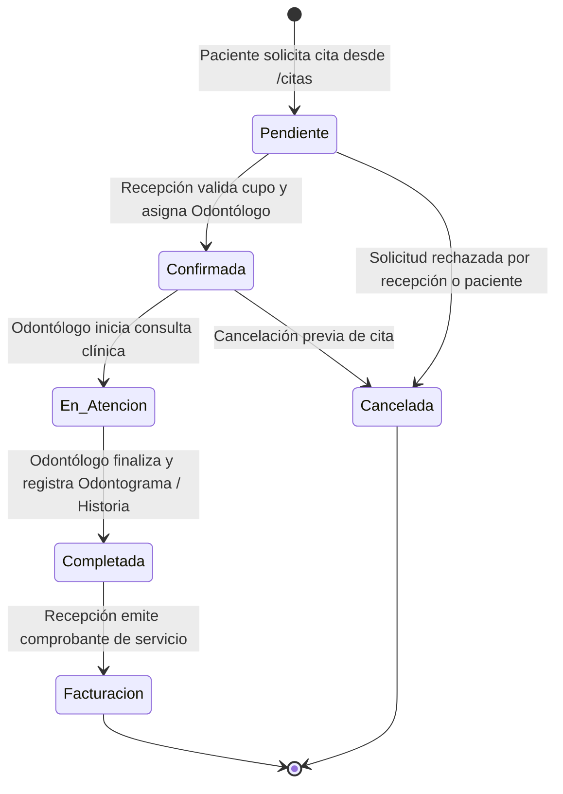

# Arquitectura del Sistema Frontend — NexusOdonto

> **Versión del Documento:** 2.1.0  
> **Estado:** Referencia Técnica Oficial del Frontend  
> **Tecnologías:** React 19, TypeScript, Vite 8, Tailwind CSS v4, React Router v7, Lucide React  
> **Última Actualización:** 2026-08-31

---

## 1. Visión General del Ecosistema

NexusOdonto Frontend es una **Single Page Application (SPA)** moderna, reactiva y desacoplada, orientada a la gestión integral de consultorios y clínicas odontológicas. Se comunica con el backend .NET mediante una API RESTful protegida con JSON Web Tokens (JWT) y políticas de control de acceso basadas en roles (RBAC).

```
┌──────────────────────────────────────────────────────────────────────────────────┐
│                      NEXUSODONTO FRONTEND (Arquitectura SPA)                     │
│  React 19 + TypeScript + Vite 8.x + Tailwind CSS v4 + Lucide React              │
│  • Context API: AuthContext (Sesión y Roles) / ThemeContext (Dark/Light)         │
│  • Interceptores Axios: Inyección Bearer JWT + Gestión Resiliente 401           │
│  • Sistema de Enrutamiento Seguro: React Router v7 + ProtectedRoute RBAC         │
│  • Componente Flotante de Asistencia: ChatBotWidget contextual por Rol          │
└────────────────────────────────────────┬─────────────────────────────────────────┘
                                         │ HTTPS / REST JSON API
                                         ▼
┌──────────────────────────────────────────────────────────────────────────────────┐
│                   BACKEND (.NET Clean Architecture - REST API)                   │
│  Controllers RESTful, DTOs con FluentValidation, Identity JWT, SQL Server EF Core│
└──────────────────────────────────────────────────────────────────────────────────┘
```

---

## 2. Estructura Real del Árbol de Carpetas (`src/`)

El código fuente sigue una estructura **Feature-Driven (Feature-First)** organizada por dominios funcionales:

```
NexusOdontoFrontend/
├── informacion.md              # Documento maestro integral de negocio y contratos
├── ARCHITECTURE.md             # Esta guía arquitectónica oficial
├── package.json                # Dependencias (React 19, Lucide, Tailwind v4, Axios)
├── tsconfig.json               # Configuración estricta de TypeScript
├── vite.config.ts              # Configuración de compilación con Vite 8
└── src/
    ├── api/                    # Servicios de comunicación HTTP desacoplados
    │   ├── axiosClient.ts      # Cliente Axios centralizado con interceptores
    │   ├── authService.ts      # Endpoints públicos de login, register y perfil
    │   ├── personService.ts    # Gestión de personas físicas (/v1/Persons)
    │   ├── userService.ts      # Gestión de usuarios del sistema (/v1/Users)
    │   ├── roleService.ts      # Catálogo de roles del sistema (/v1/Roles)
    │   ├── documentTypeService.ts # Catálogo de tipos de documento
    │   └── sexService.ts       # Catálogo de sexos/géneros
    ├── assets/                 # Recursos estáticos (Logotipos e imágenes WebP)
    │   ├── fondo-Login-ligh.webp
    │   ├── fondoLogin.webp
    │   ├── fondo-ligh.webp
    │   ├── fondo-darck.webp
    │   └── nexus-odonto-logo.webp
    ├── components/             # Componentes transversales
    │   ├── layout/
    │   │   ├── PageHeader.tsx  # Barra superior, selector de tema y avatar
    │   │   ├── Sidebar.tsx     # Menú lateral reactivo con aislamiento RBAC
    │   │   └── UserProfileDropdown.tsx # Menú flotante de perfil y logout
    │   └── chatbot/
    │       └── ChatBotWidget.tsx # Widget flotante del asistente virtual
    ├── context/                # Estados globales transversales
    │   └── ThemeContext.tsx    # Manejo de tema Claro / Oscuro
    ├── features/               # Módulos de negocio (Feature-First)
    │   ├── auth/               # Autenticación, registro público y contexto
    │   │   ├── LoginPage.tsx
    │   │   ├── RegisterPage.tsx
    │   │   ├── AuthContext.tsx # Proveedor de identidad, token y permisos
    │   │   ├── components/     # Componentes de entrada y botones de login
    │   │   └── mocks/          # Usuarios de prueba y validación dual
    │   ├── dashboard/          # Métricas inteligentes por rol
    │   │   └── DashboardPage.tsx
    │   ├── citas/              # Ciclo de vida y agendamiento de citas
    │   │   ├── CitasView.tsx   # Vista principal con modales y pestañas
    │   │   ├── types.ts        # Tipos y estados (Pendiente, Confirmada, etc.)
    │   │   └── components/
    │   │       └── CitasTable.tsx # Tabla reactiva con acciones por rol
    │   ├── pacientes/          # Directorio y admisión de pacientes
    │   │   ├── PacientesView.tsx
    │   │   ├── PacienteRegistroView.tsx
    │   │   └── components/
    │   ├── odontograma/        # Odontograma clínico interactivo
    │   │   ├── OdontogramaUI.tsx
    │   │   ├── types.ts
    │   │   └── components/     # Dientes, cuadrantes y convenciones
    │   ├── servicios/          # Catálogo de servicios y tarifas
    │   │   ├── ServiciosView.tsx
    │   │   └── ServicioRegistroView.tsx
    │   ├── usuarios/           # Gestión de personal médico y administrativo
    │   │   └── UsuariosView.tsx
    │   └── perfil/             # Gestión de cuenta de usuario
    │       └── PerfilView.tsx
    ├── layouts/                # Envoltorios de vistas
    │   └── DashboardLayout.tsx # Layout privado con Sidebar, Header y Chatbot
    ├── routes/                 # Enrutamiento de la aplicación
    │   ├── index.tsx           # AppRoutes con carga perezosa (lazy loading)
    │   └── ProtectedRoute.tsx  # Guard de protección de rutas y permisos RBAC
    ├── utils/                  # Funciones de soporte
    │   └── routePermissions.ts # Reglas de acceso a rutas por rol
    ├── index.css               # Estilos globales y tokens de diseño Tailwind v4
    └── main.tsx                # Punto de entrada de la aplicación React
```

---

## 3. Matriz de Control de Acceso Basada en Roles (RBAC)

### 3.1 Identificadores Canónicos de Roles
El sistema opera con 4 roles humanos fundamentales:

| Rol | GUID Oficial en Base de Datos | Responsabilidad Principal |
| :--- | :--- | :--- |
| **`ADMINISTRADOR`** | `13000000-0000-0000-0000-000000000001` | Control administrativo y asistencial total. Configuración, usuarios y roles. |
| **`ODONTOLOGO`** | `13000000-0000-0000-0000-000000000002` | Atención clínica, evolución de pacientes, odontograma e historias clínicas. |
| **`RECEPCIONISTA`** | `13000000-0000-0000-0000-000000000003` | Admisión de pacientes, asignación y aprobación de citas, catálogo de tarifas. |
| **`PACIENTE`** | `13000000-0000-0000-0000-000000000005` | Auto-registro, solicitud de citas propias, consulta de historial y perfil. |

---

### 3.2 Mapeo de Rutas Permitidas y Aislamiento de Seguridad

| Ruta del Frontend | PACIENTE | RECEPCIONISTA | ODONTÓLOGO | ADMINISTRADOR |
| :--- | :---: | :---: | :---: | :---: |
| `/dashboard` | Resumen Personal | Operativo General | Agenda del Día | Métricas Totales |
| `/citas` | Mis Citas (Solicitar) | Bandeja de Citas | Citas Asignadas | Control Total |
| `/agenda` | Bloqueado | Agenda Global | Agenda Clínica | Control Total |
| `/pacientes` | Bloqueado | Directorio Pacientes | Pacientes Asignados | Control Total |
| `/pacientes/nuevo` | Bloqueado | Admisión Paciente | Admisión Paciente | Control Total |
| `/profesionales` | Bloqueado | Directorio Médico | Bloqueado | Control Total |
| `/servicios` | Bloqueado | Tarifas y Servicios | Bloqueado | Control Total |
| `/historia-clinica` | Bloqueado | Bloqueado | Evolución Médica | Control Total |
| `/odontograma` | Bloqueado | Bloqueado | Registro Dental | Control Total |
| `/usuarios` | Bloqueado | Bloqueado | Bloqueado | Control Total |
| `/roles-permisos` | Bloqueado | Bloqueado | Bloqueado | Control Total |
| `/configuracion` | Bloqueado | Bloqueado | Bloqueado | Control Total |
| `/perfil` | Datos de Contacto | Datos Laborales | Datos Profesionales | Super Administrador |

> **Mecanismo de Bloqueo:** El guard `ProtectedRoute.tsx` consulta `hasRouteAccess(user, pathname)`. Si el rol no tiene la ruta permitida, bloquea la renderización y muestra la pantalla de **Acceso Restringido** con botón de redirección automática hacia `/dashboard`.

---

## 4. Arquitectura de Estilos Centralizada (`src/index.css`)

### 4.1 Variables CSS y Configuración de Tema (Tailwind CSS v4)
La identidad visual de NexusOdonto se encuentra centralizada en `src/index.css` mediante tokens en `:root` y mapeo en `@theme`:

```css
:root {
  /* Paleta Corporativa Oficial (Cian Médico, Turquesa y Menta Tech) */
  --nexus-primary-50: #E6F7FA;
  --nexus-primary-100: #B3ECF5;
  --nexus-primary-300: #4DD5EB;
  --nexus-primary-500: #00A8CC;
  --nexus-primary-600: #0093B3;
  --nexus-primary-700: #008B9B;
  --nexus-primary-900: #00505B;

  --nexus-secondary-100: #E2F8F0;
  --nexus-secondary-300: #9CE7CF;
  --nexus-secondary-500: #66D2B1;
  --nexus-secondary-700: #3AA887;

  /* Acentos de Especialidades Clínicas */
  --nexus-accent-cyan: #06B6D4;
  --nexus-accent-teal: #14B8A6;
  --nexus-accent-indigo: #6366F1;
  --nexus-accent-purple: #A855F7;
  --nexus-accent-sky: #0EA5E9;

  /* Estados Clínicos */
  --nexus-success-bg: #ECFDF5;
  --nexus-success-text: #059669;
  --nexus-warning-bg: #FFFBEB;
  --nexus-warning-text: #D97706;
  --nexus-danger-bg: #FEF2F2;
  --nexus-danger-text: #DC2626;
  --nexus-info-bg: #EFF6FF;
  --nexus-info-text: #2563EB;
}
```

### 4.2 Regla Estricta de Iconografía (Cero Emojis)
* Todos los elementos visuales de estado, botones, sugerencias de chat y alertas utilizan exclusivamente componentes de **`lucide-react`** (`CalendarDays`, `UserRound`, `Stethoscope`, `Smile`, `ShieldCheck`, `FileText`, `CheckCircle`, `AlertCircle`, `Receipt`, `UserPlus`, etc.).

---

## 5. Flujo de Negocio Clínico y Ciclo de Vida de las Citas



### 5.1 Interacción Paso a Paso
1. **Solicitud (Paciente):** El paciente hace clic en **"Solicitar Cita"** en `/citas`, seleccionando fecha tentativa, horario y motivo. La cita se registra con estado `Pendiente`.
2. **Asignación y Aprobación (Recepción / Admin):** En la pestaña de **"Solicitudes Pendientes"**, el recepcionista selecciona **"Asignar / Aprobar"**, define el odontólogo tratante y confirma la cita (`Confirmada`).
3. **Atención Médica (Odontólogo):** El doctor abre su agenda, selecciona al paciente y marca **"Atender"** (`En Atención`). Durante la consulta:
   - Abre el **Odontograma Interactivo** (`/odontograma`) para marcar hallazgos en piezas y superficies dentales.
   - Abre la **Historia Clínica** (`/historia-clinica`) para registrar la evolución médica y el diagnóstico CIE-10.
4. **Finalización:** El doctor marca **"Completar"** (`Completada`). El paciente visualiza su historial actualizado en su perfil.

---

## 6. Catálogo de Servicios API y Endpoints Consumidos

### 6.1 Autenticación (`src/api/authService.ts`)
* `POST /api/auth/login` — Autenticación con identificador dual (Cédula o Correo) + Contraseña.
* `POST /api/auth/register` — Auto-registro público asignando por defecto el rol `PACIENTE`.
* `GET /api/auth/me` — Consulta de la sesión activa y permisos.
* `POST /api/auth/refresh` — Renovación de token de sesión mediante refresh token.

### 6.2 Citas y Agenda (`/api/v1/Appointments`)
* `GET /api/v1/Appointments` — Listado de citas filtrables por rol, fecha o estado.
* `POST /api/v1/Appointments` — Solicitud o creación directa de citas.
* `PATCH /api/v1/Appointments/{id}/assign` — Asignación de doctor y consultorio.
* `PATCH /api/v1/Appointments/{id}/status` — Cambio de estado de la cita.

### 6.3 Pacientes y Personas (`/api/v1/Patients`, `/api/v1/Persons`)
* `GET /api/v1/Persons` — Catálogo general de personas.
* `GET /api/v1/Patients` — Directorio de pacientes clínicos.
* `POST /api/v1/Patients` — Admisión y creación de nuevo paciente.

### 6.4 Historia Clínica y Odontograma (`/api/v1/ClinicalHistories`, `/api/v1/Odontograms`)
* `GET /api/v1/ClinicalHistories/patient/{patientId}` — Consulta de expediente médico.
* `POST /api/v1/ClinicalAttentions` — Registro de consulta y evolución clínica.
* `GET /api/v1/Odontograms/patient/{patientId}` — Consulta de odontograma y superficies dentales.
* `POST /api/v1/DentalFindings` — Registro de patología o procedimiento en pieza dental.

---

## 7. Instrucciones para Desarrolladores

### Comandos de Desarrollo y Construcción
```bash
# Navegar al directorio del frontend
cd NexusOdontoFrontend

# Instalar dependencias
npm install

# Iniciar servidor de desarrollo con Vite
npm run dev

# Verificación estricta de tipos de TypeScript (0 errores)
npx tsc --noEmit

# Compilación para producción (generación de /dist)
npm run build
```

### Reglas de Mantenimiento
1. **Desacoplamiento HTTP:** Nunca invocar `fetch` o `axios` directamente dentro de los componentes visuales; utilizar los módulos en `src/api/`.
2. **Autorización Centralizada:** Toda nueva vista protegida debe registrarse en `ROLE_ALLOWED_ROUTES` dentro de `src/utils/routePermissions.ts`.
3. **Cero Emojis:** Mantener el estándar corporativo empleando componentes de `lucide-react`.
