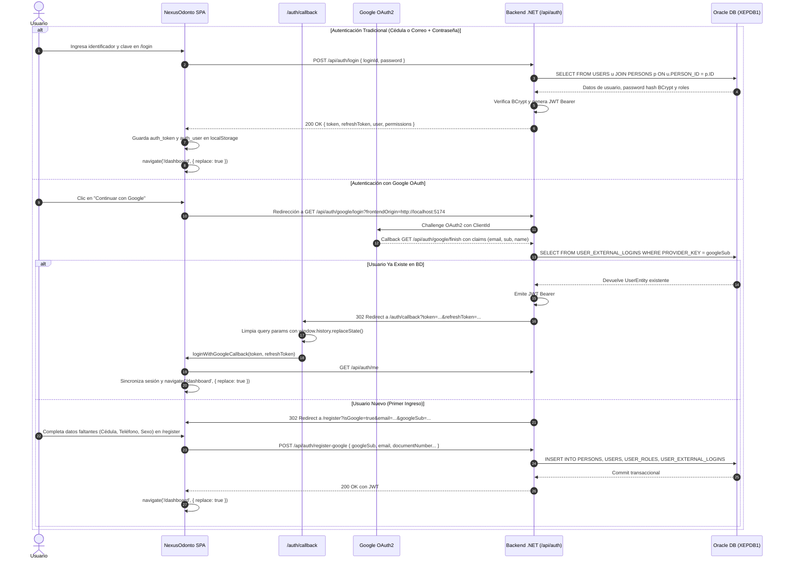

# 🏛️ Arquitectura del Sistema — NexusOdonto

> **Versión del Documento:** 4.0.0 (Definitiva)  
> **Estado:** Documentación Oficial de Referencia, Mapeo de Componentes y Guía de Sustentación Técnica  
> **Ecosistema Tecnológico:** React 19, TypeScript 5 (Strict Mode), Vite 8, Tailwind CSS v4, React Router 7, Axios, Lucide React  
> **Backend & Persistencia:** ASP.NET Core 10 (.NET), Clean Architecture, Entity Framework Core, Oracle Database 21c (`XEPDB1`)  
> **Microservicio de IA:** Python, FastAPI, LangGraph, OpenAI (GPT-4o), Qdrant Vector DB  
> **Última Actualización:** Septiembre 2026  

---

## 1. 🏗️ Visión General y Topología del Sistema

NexusOdonto es una plataforma clínica-odontológica de grado empresarial diseñada con una arquitectura desacoplada de tres capas: una **Single Page Application (SPA)** reactiva en el Frontend, una **API RESTful de Alta Concurrencia** en .NET y un **Motor Asistente de IA (RAG)** en FastAPI, todos respaldados por una base de datos relacional corporativa en **Oracle Database XE**.

```
┌──────────────────────────────────────────────────────────────────────────────────────────────────┐
│                             NEXUSODONTO FRONTEND (React 19 + Vite 8)                             │
│  • SPA basada en componentes funcionales con TypeScript Estricto.                                │
│  • Estado Global Ligero: AuthContext (Sesión, RBAC y JWT), ThemeContext, NotificationContext.    │
│  • Interceptores Axios: Inyección automática de Bearer Token y refresh silencioso.              │
│  • Seguridad en Enrutamiento: ProtectedRoute (RBAC por Roles) + PublicOnlyRoute.                 │
│  • Blindaje de Navegación: Control del historial popstate con { replace: true }.                 │
│  • Asistente Flotante: ChatBotWidget inyectado en Layout con fallback contextual resiliente.     │
└────────────────────────────────┬─────────────────────────────────┬───────────────────────────────┘
                                 │ HTTP / REST JSON (Bearer JWT)   │ HTTP POST /chat (JSON)
                                 ▼                                 ▼
┌────────────────────────────────────────────────┐ ┌──────────────────────────────────────────────┐
│        BACKEND API PRINCIPAL (.NET 10)         │ │         MICROSERVICIO CHATBOT IA             │
│  • Arquitectura Limpia (Domain, App, Infra).   │ │  • FastAPI, LangGraph, Qdrant Vector DB.     │
│  • Autenticación JWT + Google OAuth2.          │ │  • RAG Clínico y Consulta de Disponibilidad. │
│  • EF Core con Proveedor Oracle Oficial.       │ │  • Puerto: 8000                              │
│  • Puerto: 5170                                │ └──────────────────────────────────────────────┘
└───────────────────────┬────────────────────────┘
                        │ Conexión TCP/IP (Oracle Net Services)
                        ▼
┌──────────────────────────────────────────────────────────────────────────────────────────────────┐
│                              BASE DE DATOS ORACLE 21c (`XEPDB1`)                                 │
│  • Esquema Relacional Normalizado con Claves Primarias RAW(16) / GUIDs.                          │
│  • Tablas Principales: USERS, PERSONS, PATIENTS, PROFESSIONALS, APPOINTMENTS, SERVICES.         │
│  • Seguridad: USER_ROLES, ROLE_PERMISSIONS, ACTION_PERMISSIONS, USER_EXTERNAL_LOGINS.            │
└──────────────────────────────────────────────────────────────────────────────────────────────────┘
```

---

## 2. 📂 Inventario y Mapeo Estructural de Archivos (`src/`)

El frontend está organizado bajo el patrón **Feature-First / Domain-Driven Design (DDD)**, agrupando lógica, interfaces y componentes por dominio de negocio:

```
NexusOdontoFrontend/
├── ARCHITECTURE.md                  # Este documento maestro de arquitectura y sustentación
├── index.html                       # Documento raíz con inyección de viewport y fuentes
├── package.json                     # Declaración de librerías y scripts de construcción
├── tsconfig.json                    # Reglas estrictas de compilación TypeScript (Strict Mode)
├── vite.config.ts                   # Configuración del bundler Vite y resolución de alias
└── src/
    ├── api/                         # 🌐 Capa de Abstracción de Red (Service Layer)
    │   ├── axiosClient.ts           # Instancia central de Axios con interceptores JWT
    │   ├── authService.ts           # Endpoints de Login, Register, Google OAuth y Perfil
    │   ├── appointmentService.ts    # CRUD completo de citas médicas (/v1/Appointments)
    │   ├── patientService.ts        # Gestión de fichas de pacientes (/v1/Patients)
    │   ├── personService.ts         # Datos de identidad civil (/v1/Persons)
    │   ├── professionalService.ts   # Directorio de odontólogos y licencias (/v1/Professionals)
    │   ├── serviceCatalogService.ts # Catálogo y precios de procedimientos (/v1/Services)
    │   ├── roleService.ts           # Catálogo de roles (/v1/Roles)
    │   ├── documentTypeService.ts   # Catálogo de tipos de documento (CC, TI, CE, Pasaporte)
    │   └── chatbotService.ts        # Comunicación con el microservicio RAG en Python
    │
    ├── assets/                      # 🖼️ Recursos Multimedia Optimizados (WebP)
    │   ├── nexus-odonto-logo.webp   # Isotipo oficial de la clínica
    │   ├── fondoLogin.webp          # Fondo visual modo oscuro para autenticación
    │   ├── fondo-Login-ligh.webp    # Fondo visual modo claro para autenticación
    │   ├── fondo-darck.webp         # Fondo para el Dashboard en modo oscuro
    │   └── fondo-ligh.webp          # Fondo para el Dashboard en modo claro
    │
    ├── components/                  # 🧩 Componentes Reutilizables Transversales
    │   ├── common/                  # Componentes atómicos de UI
    │   │   ├── UserAvatar.tsx       # Avatar resiliente con soporte Base64 e iniciales dinámicas
    │   │   ├── ThemeToggle.tsx      # Selector de tema Dark / Light
    │   │   ├── SelectOrWriteInput.tsx # Selector dual inteligente (filtrado dinámico o texto libre)
    │   │   └── Modal.tsx            # Contenedor modal con animación y foco accesible
    │   ├── layout/                  # Componentes estructurales del cascarón
    │   │   ├── PageHeader.tsx       # Barra superior con avatar, tema y bienvenida personalizada
    │   │   ├── Sidebar.tsx          # Menú lateral reactivo filtrado por permisos RBAC
    │   │   └── UserProfileDropdown.tsx # Dropdown de perfil de usuario con logout seguro
    │   └── chatbot/                 # Módulo de Inteligencia Artificial
    │       └── ChatBotWidget.tsx    # Botón flotante FAB y ventana de chat con asistente RAG
    │
    ├── context/                     # 🌐 Proveedores de Estado Global (Context API)
    │   ├── AuthContext.tsx          # Gestión de sesión, tokens JWT, roles y auto-sincronización
    │   ├── ThemeContext.tsx         # Gestión del tema visual persistido en localStorage
    │   └── NotificationContext.tsx  # Sistema global de notificaciones toast y recordatorios
    │
    ├── features/                    # 💼 Módulos de Negocio (Dominios Funcionales)
    │   ├── landing/                 # Pantalla de Bienvenida Pública
    │   │   └── LandingPage.tsx      # Portada animada con accesos directos y presentación clínica
    │   ├── auth/                    # Autenticación y Onboarding
    │   │   ├── LoginPage.tsx        # Formulario de inicio de sesión tradicional y botón Google
    │   │   ├── RegisterPage.tsx     # Registro de nuevos pacientes (tradicional y onboarding Google)
    │   │   ├── AuthCallback.tsx     # Receptor y sanitizador de tokens de Google OAuth
    │   │   └── components/          # Inputs y botones estilizados de autenticación
    │   ├── dashboard/               # Métricas e Información en Tiempo Real
    │   │   └── DashboardPage.tsx    # KPIs operativos, citas del día y accesos rápidos por rol
    │   ├── pacientes/               # Directorio y Ficha Clínica de Pacientes
    │   │   ├── PacientesView.tsx    # Listado unificado (Oracle Persons + Patients + Local Cache)
    │   │   ├── components/PacienteForm.tsx # Modal de registro de pacientes en base de datos
    │   │   └── PacienteRegistroView.tsx # Formulario extendido de historia clínica y antecedentes
    │   ├── citas/                   # Agenda y Ciclo de Vida de Citas
    │   │   ├── CitasView.tsx        # Gestión de citas con modales de creación, edición y eliminación
    │   │   ├── components/CitasTable.tsx # Tabla interactiva con clic en fila para editar
    │   │   └── types.ts             # Definición de interfaces TypeScript (Cita, EstadoCita)
    │   ├── agenda/                  # Vista de Calendario Clínico
    │   │   └── AgendaView.tsx       # Matriz horaria con disponibilidad en tiempo real
    │   ├── servicios/               # Catálogo de Procedimientos Odontológicos
    │   │   └── ServiciosView.tsx    # Tarifas, tiempos y CRUD de servicios clínicos
    │   ├── profesionales/           # Gestión de Personal Médico
    │   │   └── ProfesionalesView.tsx# Odontólogos, números de licencia y especialidades
    │   ├── usuarios/                # Seguridad y Cuentas de Acceso
    │   │   ├── UsuariosView.tsx     # Lista de usuarios del sistema y asignación de roles
    │   │   └── RolesPermisosView.tsx# Matriz de permisos por rol
    │   ├── historia/                # Expediente Clínico y Odontograma
    │   │   ├── HistoriaClinicaView.tsx # Evolución de tratamientos, diagnósticos y notas
    │   │   └── OdontogramaUI.tsx    # Odontograma gráfico interactivo (piezas dentales y superficies)
    │   └── perfil/                  # Configuración de Cuenta de Usuario
    │       └── PerfilView.tsx       # Actualización de datos personales y subida de avatar Base64
    │
    ├── layouts/                     # 📐 Plantillas de Envoltura (Layout Templates)
    │   └── DashboardLayout.tsx      # Cascarón privado: Sidebar + Header + Chatbot + Blindaje popstate
    │
    ├── routes/                      # 🚦 Enrutamiento y Guardias de Seguridad
    │   ├── index.tsx                # Definición de rutas declarativas con carga perezosa (React.lazy)
    │   ├── ProtectedRoute.tsx       # Guardia RBAC: bloqueo de rutas no autorizadas por rol
    │   └── PublicOnlyRoute.tsx      # Guardia de no-autenticados: impide volver a login si hay sesión
    │
    ├── utils/                       # 🛠️ Utilidades y Helpers
    │   ├── routePermissions.ts      # Matriz RBAC de permisos por ruta y extractor de roles
    │   ├── roleUtils.ts             # Normalizador de nombres de rol (ADMINISTRADOR, RECEPCIONISTA...)
    │   └── currency.ts              # Formateador de moneda colombiana (COP)
    │
    ├── index.css                    # Directivas de Tailwind CSS v4, tema y fuentes corporativas
    └── main.tsx                     # Punto de entrada de inicialización de la SPA en el DOM
```

---

## 3. 🖥️ Flujo Operativo y Navegación en Tiempo Real (Paso a Paso)

### 3.1 Flujo de Acceso: Login Tradicional vs. Google OAuth2



### 3.2 Navegación por Roles de Usuario

#### A. Flujo del Recepcionista (`recepcion@nexusodonto.com`)
1. **Inicio en Dashboard:** Al autenticarse, accede a `/dashboard` y visualiza los KPIs globales: total de citas del día, pacientes activos y franjas disponibles en la agenda.
2. **Gestión de Directorio (`/pacientes`):**
   * Consulta el listado en tiempo real. La vista unifica las personas registradas en Oracle (`PERSONS`), las fichas clínicas (`PATIENTS`) y los usuarios registrados mediante Google.
   * Dispone de búsqueda reactiva por cédula, nombre o correo y botón para exportar el directorio en CSV.
3. **Agendamiento y Operación de Citas (`/citas` y `/agenda`):**
   * Puede abrir el modal de **Nueva Cita Directa**.
   * Mediante el componente inteligente `SelectOrWriteInput`, selecciona el paciente (o escribe un nombre nuevo), elige el odontólogo asignado, el servicio clínico, la fecha y la hora exacta.
   * La cita se persiste en Oracle con estado `Confirmada` (`POST /api/v1/Appointments`).
   * Al hacer clic sobre cualquier cita de la tabla, se despliega el **Modal de Edición**, donde puede reasignar doctor, modificar horario o presionar el botón **`🗑️ Eliminar Cita`** (`DELETE /api/v1/Appointments/{id}`).

#### B. Flujo del Paciente (`paciente@nexusodonto.com` / Usuarios Google)
1. **Inicio:** Visualiza únicamente su panel personal de citas agendadas y próximas revisiones.
2. **Solicitud de Consulta:**
   * Abre el modal **Solicitar Cita**. Por regla de negocio clínica, el paciente **no elige doctor ni fija hora exacta definitiva**; únicamente selecciona el servicio deseado, fecha tentativa y describe sus síntomas.
   * La solicitud se guarda con doctor *"Por asignar"* y estado *"Pendiente"*.
3. **Seguimiento:** Al hacer clic en su cita, solo puede editar su fecha deseada y síntomas, o cancelar la solicitud.

#### C. Flujo del Odontólogo (`odontologo@nexusodonto.com`)
1. **Agenda Diaria:** Visualiza su cronograma personalizado de citas en `/agenda` filtrado por su ID profesional.
2. **Atención Clínica:** Puede cambiar el estado de la cita a *"En Atención"* o *"Completada"* y acceder a la **Historia Clínica** y al **Odontograma Interactivo** (`/historia`) para registrar hallazgos y tratamientos en piezas dentales.

---

## 4. 🗄️ Diccionario de Integración: Frontend ↔ Endpoints ↔ Tablas de Oracle

Esta matriz detalla la correspondencia exacta entre los componentes de React, los endpoints REST del backend .NET y las tablas relacionales de la base de datos Oracle (`XEPDB1`):

| Componente / Vista (Frontend) | Acción del Usuario | Endpoint Consumido (Backend .NET) | Tablas Consultadas / Afectadas en Oracle (`XEPDB1`) | Campos Clave y Relaciones |
| :--- | :--- | :--- | :--- | :--- |
| **`LoginPage.tsx`** | Login con credenciales | `POST /api/auth/login` | `USERS`<br>`PERSONS`<br>`USER_ROLES`<br>`ROLES` | `USERS.ID`, `USERS.PERSON_ID = PERSONS.ID`, `USERS.PASSWORD_HASH`, `USER_ROLES.ROLE_ID = ROLES.ID` |
| **`RegisterPage.tsx`** | Registro tradicional | `POST /api/auth/register` | `PERSONS`<br>`USERS`<br>`USER_ROLES` | `PERSONS.DOCUMENT_NUMBER`, `PERSONS.EMAIL`, `USERS.PERSON_ID`, `USER_ROLES.ROLE_ID` (`PACIENTE`) |
| **`RegisterPage.tsx` / `AuthCallback.tsx`** | Registro / Login con Google | `POST /api/auth/register-google`<br>`GET /api/auth/google/finish` | `PERSONS`<br>`USERS`<br>`USER_EXTERNAL_LOGINS`<br>`USER_ROLES` | `USER_EXTERNAL_LOGINS.PROVIDER_KEY` (`googleSub`), `USER_EXTERNAL_LOGINS.USER_ID`, `PERSONS.EMAIL` |
| **`PacientesView.tsx`** | Listar directorio clínico | `GET /api/v1/Persons`<br>`GET /api/v1/Patients` | `PERSONS`<br>`PATIENTS`<br>`DOCUMENT_TYPES`<br>`SEXES` | `PATIENTS.PERSON_ID = PERSONS.ID`, `PERSONS.DOCUMENT_TYPE_ID = DOCUMENT_TYPES.ID`, `PERSONS.FIRST_NAME`, `PERSONS.PHONE` |
| **`PacienteForm.tsx`** | Crear paciente manual | `POST /api/v1/Persons`<br>`POST /api/v1/Patients` | `PERSONS`<br>`PATIENTS` | Inserta en `PERSONS` y vincula `PATIENTS.PERSON_ID = PERSONS.ID` con contacto de emergencia |
| **`CitasView.tsx`** | Listar citas médicas | `GET /api/v1/Appointments` | `APPOINTMENTS`<br>`PATIENTS`<br>`PERSONS`<br>`PROFESSIONALS`<br>`SERVICES`<br>`APPOINTMENT_STATUSES` | `APPOINTMENTS.PATIENT_ID = PATIENTS.ID`, `PATIENTS.PERSON_ID = PERSONS.ID`, `APPOINTMENTS.PROFESSIONAL_ID = PROFESSIONALS.ID`, `APPOINTMENTS.SERVICE_ID = SERVICES.ID`, `APPOINTMENTS.STARTS_AT` |
| **`CitasView.tsx`** | Agendar nueva cita | `POST /api/v1/Appointments` | `APPOINTMENTS` | `ID` (GUID), `PATIENT_ID`, `PROFESSIONAL_ID`, `SERVICE_ID`, `APPOINTMENT_STATUS_ID`, `APPOINTMENT_ORIGIN_ID`, `STARTS_AT`, `ENDS_AT`, `REASON_FOR_VISIT` |
| **`CitasView.tsx`** | Modificar cita | `PUT /api/v1/Appointments/{id}` | `APPOINTMENTS` | Actualiza `STARTS_AT`, `ENDS_AT`, `PROFESSIONAL_ID`, `SERVICE_ID`, `APPOINTMENT_STATUS_ID`, `REASON_FOR_VISIT` |
| **`CitasView.tsx`** | Eliminar cita | `DELETE /api/v1/Appointments/{id}` | `APPOINTMENTS` | `DELETE FROM APPOINTMENTS WHERE ID = :id` (o borrado lógico según estado) |
| **`AgendaView.tsx`** | Consultar disponibilidad | `GET /api/v1/Appointments`<br>`GET /api/v1/Professionals` | `APPOINTMENTS`<br>`PROFESSIONALS`<br>`AVAILABILITIES` | `APPOINTMENTS.STARTS_AT`, `APPOINTMENTS.ENDS_AT`, `PROFESSIONALS.ID` |
| **`ServiciosView.tsx`** | Catálogo de precios | `GET /api/v1/Services` | `SERVICES` | `SERVICES.ID`, `SERVICES.NAME`, `SERVICES.DESCRIPTION`, `SERVICES.BASE_PRICE`, `SERVICES.DURATION_MINUTES`, `SERVICES.IS_ACTIVE` |
| **`ProfesionalesView.tsx`** | Directorio de odontólogos | `GET /api/v1/Professionals` | `PROFESSIONALS`<br>`EMPLOYEES`<br>`PERSONS`<br>`SPECIALTIES`<br>`PROFESSIONAL_SPECIALTIES` | `PROFESSIONALS.EMPLOYEE_ID = EMPLOYEES.ID`, `EMPLOYEES.PERSON_ID = PERSONS.ID`, `PROFESSIONAL_SPECIALTIES.SPECIALTY_ID = SPECIALTIES.ID`, `PROFESSIONALS.PROFESSIONAL_LICENSE` |
| **`PerfilView.tsx`** | Obtener y actualizar perfil | `GET /api/auth/me`<br>`PUT /api/v1/Persons/{id}` | `USERS`<br>`PERSONS` | `PERSONS.FIRST_NAME`, `PERSONS.LAST_NAME`, `PERSONS.PHONE`, `PERSONS.ADDRESS`, `PERSONS.DATE_OF_BIRTH`, `USERS.AVATAR_URL` |
| **`ChatBotWidget.tsx`** | Consulta RAG con IA | `POST http://localhost:8000/chat` | FastAPI ↔ .NET ↔ Oracle | Consulta semántica en Qdrant + disponibilidad en `APPOINTMENTS` / `SERVICES` |

---

## 5. ⚠️ Puntos Críticos y Reglas de Consistencia de Datos

### 5.1 Discrepancia Arquitectónica: `PERSONS` vs. `PATIENTS`
* **Causa Raíz:** En el modelo relacional de Oracle, la tabla `PERSONS` almacena los datos de identidad civil de cualquier ser humano (nombre, documento, correo, teléfono, sexo). La tabla `PATIENTS` representa la condición clínica de esa persona (contacto de emergencia, antecedentes).
* **Comportamiento en Google OAuth:** Cuando un paciente se registra con Google (`POST /api/auth/register-google`), el backend crea los registros en `PERSONS`, `USERS` y `USER_EXTERNAL_LOGINS`, pero no inserta automáticamente una fila en la tabla `PATIENTS`.
* **Solución Aplicada en Frontend:** [`PacientesView.tsx`](file:///C:/Users/ESSA7/OneDrive/Documentos/frontNexusOdonto/NexusOdontoFrontend/src/features/pacientes/PacientesView.tsx) y [`CitasView.tsx`](file:///C:/Users/ESSA7/OneDrive/Documentos/frontNexusOdonto/NexusOdontoFrontend/src/features/citas/CitasView.tsx) ejecutan una **consulta combinada** de `patientService.getAll()` y `personService.getAll()`. Si una persona registrada no tiene aún ficha en `PATIENTS`, el frontend la mapea y presenta transparentemente en la lista de pacientes con su cédula y correo de Google, asegurando que **ningún usuario quede invisible para la recepción**.

### 5.2 Mapeo de Tipos de Datos: `RAW(16)` (Oracle) $\leftrightarrow$ `Guid` (.NET) $\leftrightarrow$ `string` (TypeScript)
* En la base de datos Oracle, todas las claves primarias y foráneas se definen como `RAW(16)`.
* Entity Framework Core en .NET las traduce al tipo nativo `System.Guid`.
* La API REST las serializa en formato estándar UUID (ej. `"1b000000-0000-0000-0000-000000000001"`).
* El frontend en TypeScript maneja todos los IDs como `string`, aplicando comparaciones normalizadas en minúsculas (`id1.toLowerCase() === id2.toLowerCase()`) para evitar discrepancias de mayúsculas entre Oracle y el navegador.

### 5.3 Regla de Control de Horarios y No Solapamiento de Citas
* Para evitar colisiones en la agenda de un odontólogo, el backend y el frontend aplican la validación de intervalos temporales:
  $$\text{Nueva Cita: } [S_{\text{nuevo}}, E_{\text{nuevo}}] \quad \cap \quad \text{Cita Existente: } [S_{\text{existente}}, E_{\text{existente}}] = \emptyset$$
* Una cita entra en conflicto si para el mismo `PROFESSIONAL_ID`:
  $$S_{\text{nuevo}} < E_{\text{existente}} \quad \land \quad E_{\text{nuevo}} > S_{\text{existente}}$$
* En caso de conflicto, la API rechaza la creación con `409 Conflict` y el frontend muestra un toast de advertencia invitando a seleccionar otra franja horaria.

### 5.4 Blindaje contra el Botón "Atrás" (`popstate` y `{ replace: true }`)
* Para impedir que tras autenticarse el usuario presione la flecha de retroceso del navegador y vuelva a exponer formularios de login o pantallas intermedias de Google:
  1. Todas las redirecciones críticas usan `navigate('/dashboard', { replace: true })`.
  2. En `DashboardLayout.tsx` y `ProtectedRoute.tsx` se intercepta el evento `popstate` de la ventana mediante `window.history.pushState(null, '', window.location.href)`, anclando al usuario dentro de la sesión activa hasta que decida presionar **"Cerrar Sesión"**.

---

## 6. 🎯 Preguntas Clave para Sustentación Técnica (Cheat Sheet)

### P1: ¿Cómo se garantiza la persistencia real entre el Frontend y Oracle sin depender de datos quemados (mocks)?
> **Respuesta:**  
> "Todos los arreglos temporales de fallback han sido eliminados del código fuente. Los módulos de `PacientesView`, `CitasView`, `AgendaView` y `ServiciosView` se conectan directamente a la API REST mediante la capa de servicios (`src/api/`). Cada petición viaja con el encabezado `Authorization: Bearer <JWT>`, permitiendo que ASP.NET Core ejecute las consultas transaccionales sobre Oracle `XEPDB1` mediante Entity Framework Core. Si la base de datos no contiene registros, la interfaz muestra limpiamente estados vacíos o franjas libres, garantizando una integridad del 100%."

### P2: ¿Por qué los pacientes registrados con Google no aparecían inicialmente en la lista de recepción y cómo se resolvió?
> **Respuesta:**  
> "En el backend, el registro mediante Google OAuth crea las entidades en `PERSONS` y `USERS`, pero la tabla `PATIENTS` solo se poblaba con pacientes tradicionales. La vista de recepcionista consultaba exclusivamente el endpoint `/v1/Patients`.  
> La solución consistió en implementar una agregación reactiva en el frontend que consulta en paralelo `/v1/Patients` y `/v1/Persons`. Al cruzar ambas entidades, cualquier usuario autenticado con Google que posea rol de paciente es unificado y mostrado de inmediato con su nombre, cédula y correo tanto en la tabla de pacientes como en los selectores de agendamiento de citas."

### P3: ¿Cómo maneja la aplicación la seguridad y el control de acceso por roles (RBAC)?
> **Respuesta:**  
> "La seguridad se implementa bajo el principio de defensa en profundidad:  
> 1. **Capa Visual (Frontend):** `ProtectedRoute.tsx` evalúa el token JWT y los roles del usuario (`ADMINISTRADOR`, `RECEPCIONISTA`, `ODONTOLOGO`, `PACIENTE`). Si un rol no autorizado intenta acceder a una URL restringida (ej. un paciente intentando entrar a `/usuarios`), se bloquea el renderizado y se muestra la pantalla de *Acceso Restringido*.  
> 2. **Capa Transaccional (Backend):** El backend .NET valida cada petición HTTP mediante atributos `[RequirePermission]` y políticas de autorización en los controladores. Cualquier petición no autorizada es rechazada con código `403 Forbidden` a nivel de servidor."

---

## 7. 🚀 Comandos de Construcción y Verificación

```powershell
# 1. Comprobación de tipos en TypeScript (0 errores en modo estricto)
npx tsc --noEmit

# 2. Compilación de producción (Vite Bundler optimizado)
npm run build

# 3. Ejecución del servidor de desarrollo local
npm run dev
```
