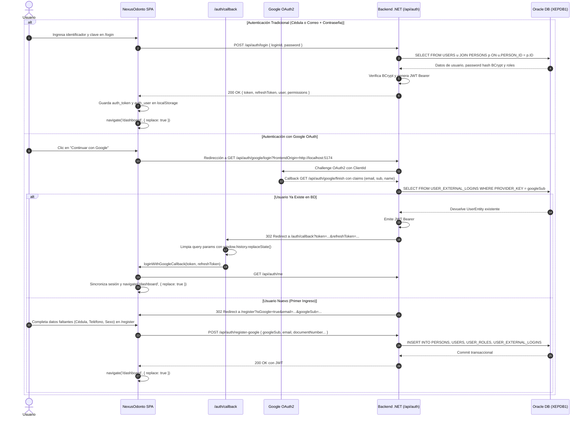

# 🏛️ Arquitectura del Sistema — NexusOdonto

> **Versión del Documento:** 5.0.0 (Definitiva y Actualizada)  
> **Estado:** Documentación Oficial de Referencia, Mapeo Estructural del Frontend y Guía de Sustentación Técnica  
> **Ecosistema Tecnológico:** React 19, TypeScript 5 (Strict Mode), Vite 8, Tailwind CSS v4, React Router 7, Axios, Lucide React, Google Fonts (`Playfair Display`, `Plus Jakarta Sans`)  
> **Backend & Persistencia:** ASP.NET Core 10 (.NET), Clean Architecture, Entity Framework Core, Oracle Database 21c (`XEPDB1`)  
> **Microservicio de IA:** Python, FastAPI, LangGraph, OpenAI (GPT-4o), Qdrant Vector DB  
> **Última Actualización:** Septiembre 2026  

---

## 1. 🏗️ Visión General y Topología del Sistema

NexusOdonto es una plataforma clínica-odontológica de grado empresarial diseñada con una arquitectura desacoplada de tres capas: una **Single Page Application (SPA)** reactiva en el Frontend, una **API RESTful de Alta Concurrencia** en .NET y un **Motor Asistente de IA (RAG)** en FastAPI, todos respaldados por una base de datos relacional corporativa en **Oracle Database XE**.

```
┌──────────────────────────────────────────────────────────────────────────────────────────────────┐
│                             NEXUSODONTO FRONTEND (React 19 + Vite 8)                             │
│  • SPA basada en componentes funcionales con TypeScript Estricto.                                │
│  • Estado Global Ligero: AuthContext (Sesión, RBAC y JWT), ThemeContext, NotificationContext.    │
│  • Interceptores Axios: Inyección automática de Bearer Token y refresh silencioso.              │
│  • Seguridad en Enrutamiento: ProtectedRoute (RBAC por Roles) + PublicOnlyRoute.                 │
│  • Blindaje de Navegación: Control del historial popstate con { replace: true }.                 │
│  • Páginas de Error Editoriales: ErrorAccessPage (401/403) y NotFoundPage (404) con fondos.      │
│  • Identidad de Marca: Componente dinámico BrandLogo (Modo Claro / Oscuro) e isotipo WebP.      │
│  • Asistente Flotante: ChatBotWidget inyectado en Layout con fallback contextual resiliente.     │
└────────────────────────────────┬─────────────────────────────────┬───────────────────────────────┘
                                 │ HTTP / REST JSON (Bearer JWT)   │ HTTP POST /chat (JSON)
                                 ▼                                 ▼
┌────────────────────────────────────────────────┐ ┌──────────────────────────────────────────────┐
│        BACKEND API PRINCIPAL (.NET 10)         │ │         MICROSERVICIO CHATBOT IA             │
│  • Arquitectura Limpia (Domain, App, Infra).   │ │  • FastAPI, LangGraph, Qdrant Vector DB.     │
│  • Autenticación JWT + Google OAuth2.          │ │  • RAG Clínico y Consulta de Disponibilidad. │
│  • EF Core con Proveedor Oracle Oficial.       │ │  • Puerto: 8000                              │
│  • Puerto: 5170                                │ └──────────────────────────────────────────────┘
└───────────────────────┬────────────────────────┘
                        │ Conexión TCP/IP (Oracle Net Services)
                        ▼
┌──────────────────────────────────────────────────────────────────────────────────────────────────┐
│                              BASE DE DATOS ORACLE 21c (`XEPDB1`)                                 │
│  • Esquema Relacional Normalizado con Claves Primarias RAW(16) / GUIDs.                          │
│  • Tablas Principales: USERS, PERSONS, PATIENTS, PROFESSIONALS, APPOINTMENTS, SERVICES.         │
│  • Seguridad: USER_ROLES, ROLE_PERMISSIONS, ACTION_PERMISSIONS, USER_EXTERNAL_LOGINS.            │
└──────────────────────────────────────────────────────────────────────────────────────────────────┘
```

---

## 2. 📂 Inventario y Mapeo Estructural de Archivos (`src/`)

El frontend está organizado bajo el patrón **Feature-First / Domain-Driven Design (DDD)**, agrupando lógica, interfaces y componentes por dominio de negocio:

```
NexusOdontoFrontend/
├── ARCHITECTURE.md                  # Este documento maestro de arquitectura y sustentación
├── index.html                       # Documento raíz con inyección de fuentes Playfair Display y favicon SVG
├── package.json                     # Declaración de librerías y scripts de construcción
├── tsconfig.json                    # Reglas estrictas de compilación TypeScript (Strict Mode)
├── vite.config.ts                   # Configuración del bundler Vite y plugins de React
├── public/                          # Recursos Estáticos Servidos Directamente
│   ├── favicon.svg                  # Favicon vectorial cuadrado (1:1) de alta fidelidad
│   ├── favicon.webp                 # Isotipo cuadrado 1:1 transparente
│   ├── icons.svg                    # Sprites SVG de redes y utilidades
│   └── robots.txt                   # Instrucciones de indexación para motores de búsqueda
│
└── src/
    ├── api/                         # 🌐 Capa de Abstracción de Red (Service Layer)
    │   ├── axiosClient.ts           # Instancia central de Axios con interceptores JWT
    │   ├── authService.ts           # Endpoints de Login, Register, Google OAuth y Perfil
    │   ├── appointmentService.ts    # CRUD completo de citas médicas (/v1/Appointments)
    │   ├── patientService.ts        # Gestión de fichas de pacientes (/v1/Patients)
    │   ├── personService.ts         # Datos de identidad civil (/v1/Persons)
    │   ├── professionalService.ts   # Directorio de odontólogos y licencias (/v1/Professionals)
    │   ├── employeeService.ts      # Gestión de empleados clínicos y administrativos
    │   ├── specialtyService.ts      # Catálogo de especialidades odontológicas
    │   ├── sexService.ts            # Catálogo de sexos biológicos para historia clínica
    │   ├── serviceCatalogService.ts # Catálogo y precios de procedimientos (/v1/Services)
    │   ├── roleService.ts           # Catálogo de roles (/v1/Roles)
    │   ├── documentTypeService.ts   # Catálogo de tipos de documento (CC, TI, CE, Pasaporte)
    │   └── chatbotService.ts        # Comunicación con el microservicio RAG en Python
    │
    ├── assets/                      # 🖼️ Recursos Multimedia Optimizados (WebP)
    │   ├── nexus-odonto-logo.webp   # Isotipo oficial transparente de la clínica
    │   ├── fondoLogin.webp          # Fondo visual modo oscuro para autenticación
    │   ├── fondo-Login-ligh.webp    # Fondo visual modo claro para autenticación
    │   ├── fondo-darck.webp         # Fondo para el Dashboard en modo oscuro
    │   ├── fondo-ligh.webp          # Fondo para el Dashboard en modo claro
    │   ├── error_403_darck.webp     # Fondo modo oscuro para vistas 401 y 403
    │   ├── error_403_light.webp     # Fondo modo claro para vistas 401 y 403
    │   ├── error_404_darck.webp     # Fondo modo oscuro para vista 404
    │   └── error_404_light.webp     # Fondo modo claro para vista 404
    │
    ├── components/                  # 🧩 Componentes Reutilizables Transversales
    │   ├── common/                  # Componentes atómicos de UI
    │   │   ├── BrandLogo.tsx        # Isotipo + tipografía adaptativa Light/Dark en tiempo real
    │   │   ├── UserAvatar.tsx       # Avatar resiliente con soporte Base64 e iniciales dinámicas
    │   │   ├── ThemeToggle.tsx      # Selector de tema Dark / Light
    │   │   ├── SelectOrWriteInput.tsx # Selector dual inteligente (filtrado dinámico o texto libre)
    │   │   ├── ErrorBoundary.tsx    # Capturador de excepciones React en tiempo de renderizado
    │   │   └── Modal.tsx            # Contenedor modal con animación y foco accesible
    │   ├── layout/                  # Componentes estructurales del cascarón
    │   │   ├── PageHeader.tsx       # Barra superior con avatar, tema y bienvenida personalizada
    │   │   ├── Sidebar.tsx          # Menú lateral reactivo filtrado por permisos RBAC con modo colapsable
    │   │   └── UserProfileDropdown.tsx # Dropdown de perfil de usuario con logout seguro
    │   └── chatbot/                 # Módulo de Inteligencia Artificial
    │       └── ChatBotWidget.tsx    # Botón flotante FAB y ventana de chat con asistente RAG
    │
    ├── context/                     # 🌐 Proveedores de Estado Global (Context API)
    │   ├── AuthContext.tsx          # Gestión de sesión, tokens JWT, roles y auto-sincronización
    │   ├── ThemeContext.tsx         # Gestión del tema visual persistido en localStorage
    │   └── NotificationContext.tsx  # Sistema global de notificaciones toast y recordatorios
    │
    ├── features/                    # 💼 Módulos de Negocio (Dominios Funcionales)
    │   ├── landing/                 # Pantalla de Bienvenida Pública
    │   │   └── LandingPage.tsx      # Portada animada con accesos directos y presentación clínica
    │   ├── auth/                    # Autenticación, Onboarding y Errores de Acceso
    │   │   ├── LoginPage.tsx        # Formulario de inicio de sesión tradicional y botón Google
    │   │   ├── RegisterPage.tsx     # Registro de nuevos pacientes (tradicional y onboarding Google)
    │   │   ├── AuthCallback.tsx     # Receptor y sanitizador de tokens de Google OAuth
    │   │   ├── ErrorAccessPage.tsx  # Pantalla editorial inmersiva para errores 401 y 403
    │   │   └── components/          # Inputs y botones estilizados de autenticación
    │   ├── dashboard/               # Métricas e Información en Tiempo Real
    │   │   └── DashboardPage.tsx    # KPIs operativos, citas del día y accesos rápidos por rol
    │   ├── pacientes/               # Directorio y Ficha Clínica de Pacientes
    │   │   ├── PacientesView.tsx    # Listado unificado (Oracle Persons + Patients + Local Cache)
    │   │   ├── components/PacienteForm.tsx # Modal de registro de pacientes en base de datos
    │   │   └── PacienteRegistroView.tsx # Formulario extendido de historia clínica y antecedentes
    │   ├── citas/                   # Agenda y Ciclo de Vida de Citas
    │   │   ├── CitasView.tsx        # Gestión de citas con modales de creación, edición y eliminación
    │   │   ├── components/CitasTable.tsx # Tabla interactiva con clic en fila para editar
    │   │   └── types.ts             # Definición de interfaces TypeScript (Cita, EstadoCita)
    │   ├── agenda/                  # Vista de Calendario Clínico
    │   │   ├── AgendaView.tsx       # Matriz horaria con disponibilidad en tiempo real
    │   │   └── AgendaData.tsx       # Estructuras de datos de turnos y bloques horarios
    │   ├── servicios/               # Catálogo de Procedimientos Odontológicos
    │   │   ├── ServiciosView.tsx    # Tarifas, tiempos y CRUD de servicios clínicos
    │   │   └── ServicioRegistroView.tsx # Formulario de creación de nuevos servicios
    │   ├── profesionales/           # Gestión de Personal Médico
    │   │   └── ProfesionalesView.tsx# Odontólogos, números de licencia y especialidades
    │   ├── usuarios/                # Seguridad y Cuentas de Acceso
    │   │   ├── UsuariosView.tsx     # Lista de usuarios del sistema y asignación de roles
    │   │   └── components/UsuariosTable.tsx # Tabla interactiva de gestión de cuentas
    │   ├── roles/                   # Control de Acceso Basado en Roles (RBAC)
    │   │   └── RolesPermisosView.tsx# Matriz interactiva de permisos por rol
    │   ├── historia-clinica/        # Expediente Clínico Digital
    │   │   └── HistoriaClinicaView.tsx # Evolución de tratamientos, diagnósticos y notas
    │   ├── odontograma/             # Odontograma Gráfico Interactivo
    │   │   ├── OdontogramaUI.tsx    # Interfaz completa del odontograma
    │   │   └── components/          # Componentes del odontograma (Tooth, Grid, Convenciones)
    │   │       ├── Tooth.tsx        # Renderizado interactivo de superficies dentales
    │   │       ├── OdontogramaGrid.tsx # Cuadrícula de arcadas superior e inferior
    │   │       ├── ConvencionesToolbar.tsx # Barra de herramientas de diagnósticos dentales
    │   │       └── DetalleTratamientoModal.tsx # Modal de detalle de procedimientos por diente
    │   ├── configuracion/           # Parámetros del Sistema
    │   │   └── ConfiguracionView.tsx# Configuración general y ajustes de la clínica
    │   └── perfil/                  # Configuración de Cuenta de Usuario
    │       └── PerfilView.tsx       # Actualización de datos personales y subida de avatar Base64
    │
    ├── pages/                       # 📄 Páginas de Nivel Superior
    │   └── NotFoundPage.tsx         # Pantalla editorial inmersiva para error 404 (Not Found)
    │
    ├── layouts/                     # 📐 Plantillas de Envoltura (Layout Templates)
    │   └── DashboardLayout.tsx      # Cascarón privado: Sidebar + Header + Chatbot + Blindaje popstate
    │
    ├── routes/                      # 🚦 Enrutamiento y Guardias de Seguridad
    │   ├── index.tsx                # Definición de rutas declarativas con carga perezosa (React.lazy)
    │   ├── ProtectedRoute.tsx       # Guardia RBAC: bloqueo de rutas no autorizadas por rol
    │   └── PublicOnlyRoute.tsx      # Guardia de no-autenticados: impide volver a login si hay sesión
    │
    ├── utils/                       # 🛠️ Utilidades y Helpers
    │   ├── routePermissions.ts      # Matriz RBAC de permisos por ruta y extractor de roles
    │   ├── roleUtils.ts             # Normalizador de nombres de rol (ADMINISTRADOR, RECEPCIONISTA...)
    │   └── currency.ts              # Formateador de moneda colombiana (COP)
    │
    ├── index.css                    # Directivas de Tailwind CSS v4, tema y fuentes corporativas
    └── main.tsx                     # Punto de entrada de inicialización de la SPA en el DOM
```

---

## 3. 🎨 Sistema de Diseño y Pantallas de Error Editoriales

### 3.1 Componente Unificado de Marca: `BrandLogo.tsx`
El componente [`BrandLogo.tsx`](file:///c:/Users/ESSA7/OneDrive/Documentos/frontNexusOdonto/NexusOdontoFrontend/src/components/common/BrandLogo.tsx) centraliza la identidad visual de la plataforma en modo Claro y Oscuro:
* **Isotipo Oficial:** Utiliza [`nexus-odonto-logo.webp`](file:///c:/Users/ESSA7/OneDrive/Documentos/frontNexusOdonto/NexusOdontoFrontend/src/assets/nexus-odonto-logo.webp) con fondo transparente y proporción fija.
* **Tipografía Dinámica Adaptativa:**
  * **Modo Claro:** `Nexus` en grafito (`text-slate-900`) y `Odonto` en verde azulado (`text-teal-700`).
  * **Modo Oscuro:** `Nexus` en blanco puro (`dark:text-white`) y `Odonto` en verde esmeralda brillante (`dark:text-teal-400`).
* **Soporte para Sidebar Colapsado y Desplegado:** Cabecera 100% horizontal con altura constante `h-16 px-3`. En modo colapsado (`w-20`), el isotipo oficial se renderiza centrado y con tamaño real (`h-9 w-9 min-w-[36px] min-h-[36px] flex-shrink-0`) dentro de un botón interactivo que expande el menú al clic, eliminando botones apretados en segundas filas. En modo desplegado (`w-64`), presenta logo + texto a la izquierda y botón de colapso (`<`) a la derecha.

### 3.2 Vistas Editoriales Inmersivas (401, 403, 404)
Las pantallas de error adoptan un diseño asimétrico a pantalla completa:
* **Tipografía de Alto Impacto:** Número de estado gigante (`401`, `403`, `404`) en fuente serif `Playfair Display` con degradado metálico/cristal (`from-white via-[#c7e9f7] to-[#5a93aa]`) y sombra tridimensional profunda.
* **Titular en Dos Tonos:** Texto blanco con remate en cyan luminoso (`text-cyan-400`).
* **Fondos Dinámicos por Tema:**
  * `401` y `403`: `error_403_darck.webp` en modo oscuro / `error_403_light.webp` en modo claro.
  * `404`: `error_404_darck.webp` en modo oscuro / `error_404_light.webp` en modo claro.
* **Máscara Asimétrica Suave:** `bg-gradient-to-r from-slate-950/95 via-slate-950/70 to-transparent` que garantiza máxima legibilidad a la izquierda y deja libre la ilustración del consultorio a la derecha.

---

## 4. 🖥️ Flujo Operativo y Navegación en Tiempo Real

### 4.1 Flujo de Acceso: Login Tradicional vs. Google OAuth2



### 4.2 Navegación por Roles de Usuario

#### A. Flujo del Administrador / Recepcionista (`recepcion@nexusodonto.com`)
1. **Inicio en Dashboard:** Accede a `/dashboard` y visualiza métricas de citas, pacientes activos y franjas horarias.
2. **Directorio Clínico (`/pacientes`):** Consulta unificada de personas en Oracle (`PERSONS`), fichas clínicas (`PATIENTS`) y usuarios Google con búsqueda reactiva.
3. **Agendamiento y Operación de Citas (`/citas` y `/agenda`):**
   * Agendamiento con `SelectOrWriteInput` para selección flexible de paciente, odontólogo y servicio.
   * Persistencia en Oracle (`POST /api/v1/Appointments`) con validación de no-solapamiento.
   * Modificación y cancelación/eliminación directa (`DELETE /api/v1/Appointments/{id}`).

#### B. Flujo del Paciente (`paciente@nexusodonto.com` / Usuarios Google)
1. **Inicio:** Visualiza su panel personal con sus citas y tratamientos programados.
2. **Solicitud de Cita:** Selecciona el servicio clínico y fecha tentativa; el sistema la registra como *"Pendiente"* con doctor *"Por asignar"*.

#### C. Flujo del Odontólogo (`odontologo@nexusodonto.com`)
1. **Agenda Diaria:** Visualiza su cronograma en `/agenda` filtrado por su ID profesional.
2. **Atención e Historia Clínica (`/historia-clinica` y `/odontograma`):** Actualización de diagnósticos, notas de evolución y marcado de piezas y superficies dentales en el odontograma.

---

## 5. 🗄️ Diccionario de Integración: Frontend ↔ Endpoints ↔ Tablas de Oracle

| Componente / Vista (Frontend) | Acción del Usuario | Endpoint Consumido (Backend .NET) | Tablas Consultadas / Afectadas en Oracle (`XEPDB1`) | Campos Clave y Relaciones |
| :--- | :--- | :--- | :--- | :--- |
| **`LoginPage.tsx`** | Login con credenciales | `POST /api/auth/login` | `USERS`<br>`PERSONS`<br>`USER_ROLES`<br>`ROLES` | `USERS.ID`, `USERS.PERSON_ID = PERSONS.ID`, `USERS.PASSWORD_HASH`, `USER_ROLES.ROLE_ID = ROLES.ID` |
| **`RegisterPage.tsx`** | Registro tradicional | `POST /api/auth/register` | `PERSONS`<br>`USERS`<br>`USER_ROLES` | `PERSONS.DOCUMENT_NUMBER`, `PERSONS.EMAIL`, `USERS.PERSON_ID`, `USER_ROLES.ROLE_ID` (`PACIENTE`) |
| **`RegisterPage.tsx` / `AuthCallback.tsx`** | Registro / Login con Google | `POST /api/auth/register-google`<br>`GET /api/auth/google/finish` | `PERSONS`<br>`USERS`<br>`USER_EXTERNAL_LOGINS`<br>`USER_ROLES` | `USER_EXTERNAL_LOGINS.PROVIDER_KEY` (`googleSub`), `USER_EXTERNAL_LOGINS.USER_ID`, `PERSONS.EMAIL` |
| **`PacientesView.tsx`** | Listar directorio clínico | `GET /api/v1/Persons`<br>`GET /api/v1/Patients` | `PERSONS`<br>`PATIENTS`<br>`DOCUMENT_TYPES`<br>`SEXES` | `PATIENTS.PERSON_ID = PERSONS.ID`, `PERSONS.DOCUMENT_TYPE_ID = DOCUMENT_TYPES.ID`, `PERSONS.FIRST_NAME`, `PERSONS.PHONE` |
| **`PacienteForm.tsx`** | Crear paciente manual | `POST /api/v1/Persons`<br>`POST /api/v1/Patients` | `PERSONS`<br>`PATIENTS` | Inserta en `PERSONS` y vincula `PATIENTS.PERSON_ID = PERSONS.ID` con contacto de emergencia |
| **`CitasView.tsx`** | Listar citas médicas | `GET /api/v1/Appointments` | `APPOINTMENTS`<br>`PATIENTS`<br>`PERSONS`<br>`PROFESSIONALS`<br>`SERVICES`<br>`APPOINTMENT_STATUSES` | `APPOINTMENTS.PATIENT_ID = PATIENTS.ID`, `PATIENTS.PERSON_ID = PERSONS.ID`, `APPOINTMENTS.PROFESSIONAL_ID = PROFESSIONALS.ID`, `APPOINTMENTS.SERVICE_ID = SERVICES.ID`, `APPOINTMENTS.STARTS_AT` |
| **`CitasView.tsx`** | Agendar nueva cita | `POST /api/v1/Appointments` | `APPOINTMENTS` | `ID` (GUID), `PATIENT_ID`, `PROFESSIONAL_ID`, `SERVICE_ID`, `APPOINTMENT_STATUS_ID`, `APPOINTMENT_ORIGIN_ID`, `STARTS_AT`, `ENDS_AT`, `REASON_FOR_VISIT` |
| **`CitasView.tsx`** | Modificar cita | `PUT /api/v1/Appointments/{id}` | `APPOINTMENTS` | Actualiza `STARTS_AT`, `ENDS_AT`, `PROFESSIONAL_ID`, `SERVICE_ID`, `APPOINTMENT_STATUS_ID`, `REASON_FOR_VISIT` |
| **`CitasView.tsx`** | Eliminar cita | `DELETE /api/v1/Appointments/{id}` | `APPOINTMENTS` | `DELETE FROM APPOINTMENTS WHERE ID = :id` (o borrado lógico según estado) |
| **`AgendaView.tsx`** | Consultar disponibilidad | `GET /api/v1/Appointments`<br>`GET /api/v1/Professionals` | `APPOINTMENTS`<br>`PROFESSIONALS`<br>`AVAILABILITIES` | `APPOINTMENTS.STARTS_AT`, `APPOINTMENTS.ENDS_AT`, `PROFESSIONALS.ID` |
| **`ServiciosView.tsx`** | Catálogo de precios | `GET /api/v1/Services` | `SERVICES` | `SERVICES.ID`, `SERVICES.NAME`, `SERVICES.DESCRIPTION`, `SERVICES.BASE_PRICE`, `SERVICES.DURATION_MINUTES`, `SERVICES.IS_ACTIVE` |
| **`ProfesionalesView.tsx`** | Directorio de odontólogos | `GET /api/v1/Professionals`<br>`GET /api/v1/Specialties` | `PROFESSIONALS`<br>`EMPLOYEES`<br>`PERSONS`<br>`SPECIALTIES`<br>`PROFESSIONAL_SPECIALTIES` | `PROFESSIONALS.EMPLOYEE_ID = EMPLOYEES.ID`, `EMPLOYEES.PERSON_ID = PERSONS.ID`, `PROFESSIONAL_SPECIALTIES.SPECIALTY_ID = SPECIALTIES.ID`, `PROFESSIONALS.PROFESSIONAL_LICENSE` |
| **`OdontogramaUI.tsx`** | Guardar estado dental | `GET /api/v1/Odontogram/{patientId}`<br>`POST /api/v1/Odontogram` | `ODONTOGRAMS`<br>`ODONTOGRAM_DETAILS`<br>`DENTAL_PIECES`<br>`DENTAL_SURFACES` | `ODONTOGRAMS.PATIENT_ID`, `ODONTOGRAM_DETAILS.PIECE_NUMBER`, `ODONTOGRAM_DETAILS.SURFACE`, `ODONTOGRAM_DETAILS.DIAGNOSIS_CODE` |
| **`PerfilView.tsx`** | Obtener y actualizar perfil | `GET /api/auth/me`<br>`PUT /api/v1/Persons/{id}` | `USERS`<br>`PERSONS` | `PERSONS.FIRST_NAME`, `PERSONS.LAST_NAME`, `PERSONS.PHONE`, `PERSONS.ADDRESS`, `PERSONS.DATE_OF_BIRTH`, `USERS.AVATAR_URL` |
| **`ChatBotWidget.tsx`** | Consulta RAG con IA | `POST http://localhost:8000/chat` | FastAPI ↔ .NET ↔ Oracle | Consulta semántica en Qdrant + disponibilidad en `APPOINTMENTS` / `SERVICES` |

---

## 6. ⚠️ Puntos Críticos y Reglas de Consistencia de Datos

### 6.1 Discrepancia Arquitectónica: `PERSONS` vs. `PATIENTS`
* **Causa Raíz:** En Oracle, `PERSONS` guarda los datos civiles de cualquier individuo. `PATIENTS` representa el rol clínico.
* **Comportamiento en Google OAuth:** El registro con Google crea registros en `PERSONS`, `USERS` y `USER_EXTERNAL_LOGINS`, pero no necesariamente una fila en `PATIENTS`.
* **Solución en Frontend:** [`PacientesView.tsx`](file:///c:/Users/ESSA7/OneDrive/Documentos/frontNexusOdonto/NexusOdontoFrontend/src/features/pacientes/PacientesView.tsx) ejecuta una agregación en paralelo de `patientService.getAll()` y `personService.getAll()`, garantizando que todos los usuarios registrados aparezcan en el directorio de recepción.

### 6.2 Mapeo de Tipos de Datos: `RAW(16)` $\leftrightarrow$ `Guid` $\leftrightarrow$ `string`
* En Oracle las claves son `RAW(16)`. EF Core las maneja como `System.Guid`.
* La API REST las serializa en formato UUID estándar (`"1b000000-0000-0000-0000-000000000001"`).
* El frontend TypeScript normaliza todas las comparaciones con `.toLowerCase()` para evitar errores de sensibilidad a mayúsculas.

### 6.3 Regla de Control de Horarios y No Solapamiento
$$\text{Nueva Cita: } [S_{\text{nuevo}}, E_{\text{nuevo}}] \quad \cap \quad \text{Cita Existente: } [S_{\text{existente}}, E_{\text{existente}}] = \emptyset$$
Una cita entra en conflicto si para el mismo `PROFESSIONAL_ID`:
$$S_{\text{nuevo}} < E_{\text{existente}} \quad \land \quad E_{\text{nuevo}} > S_{\text{existente}}$$

### 6.4 Blindaje contra el Botón "Atrás" (`popstate` y `{ replace: true }`)
* Las transiciones de autenticación usan `navigate('/dashboard', { replace: true })`.
* `DashboardLayout.tsx` y `ProtectedRoute.tsx` interceptan el evento `popstate` con `window.history.pushState(null, '', window.location.href)` para evitar exponer formularios cerrados sin haber hecho logout explícito.

---

## 7. 🚀 Comandos de Construcción y Verificación

```powershell
# 1. Comprobación estricta de tipos TypeScript (0 errores)
npx tsc --noEmit

# 2. Compilación de producción (Vite Bundler optimizado)
npm run build

# 3. Servidor de desarrollo local
npm run dev
```
