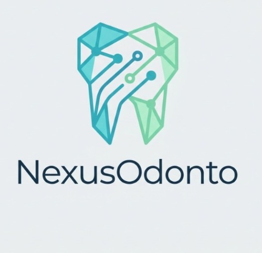

# 🦷 NexusOdonto — Frontend

<div align="center">



### **Plataforma Integral de Gestión Odontológica y Asistente Clínico Inteligente**
#### *Single Page Application (SPA), Odontograma Anatómico FDI Multisuperficie, Agenda Inteligente con Dossier de Citas & Experiencia de Usuario de Última Generación*

[](https://react.dev/)
[](https://www.typescriptlang.org/)
[](https://vitejs.dev/)
[](https://tailwindcss.com/)
[](https://learn.microsoft.com/aspnet/core/signalr/)
[](https://developers.google.com/identity)
[](https://react-pdf.org/)
[](#)
[](#)

</div>

---

## 📖 Acerca de NexusOdonto

**NexusOdonto** es una plataforma web médica de grado empresarial diseñada para la administración integral, clínica, operativa y financiera de centros odontológicos modernos. 

Ofrece una interfaz ultrarrápida y reactiva, gestión en tiempo real de citas mediante WebSockets (SignalR), expediente clínico digital unificado (CIE-10), un **odontograma interactivo anatómico multisuperficie (FDI)** con exportación dual (JSON y PDF), agenda interactiva con tarjetas minimalistas y dossiers desplegables, y un **asistente de Inteligencia Artificial (RAG)** para agendamiento autónomo y soporte omnicanal (Web y WhatsApp).

---

## 🚀 Módulos y Características Principales

### 🔐 1. Autenticación Híbrida y Control de Acceso (RBAC)
* **Inicio de Sesión Multicanal:** Soporte para **Número de Documento**, **Código de Empleado (AD001, OD001, RC001)**, **Correo Electrónico** y **Google OAuth 2.0 con un solo clic**.
* **Vinculación Dinámica de Cuentas:** Capacidad de vincular o desvincular cuentas de Google directamente desde el perfil de usuario.
* **Control de Acceso Basado en Roles (RBAC):** Vistas y flujos especializados para **Administrador**, **Odontólogo**, **Recepcionista**, **Paciente** y **Asistente**.
* **Restricción de Privilegios Financieros y de Catálogo:**
  - Los ingresos y métricas financieras en el Dashboard son de acceso exclusivo para el Administrador.
  - El catálogo de servicios y tarifas está restringido a modo lectura para Odontólogos y Recepcionistas (solo el Administrador puede crear, editar o eliminar tarifas).
* **Seguridad de Rutas:** Guardianes de ruta (`ProtectedRoute`), refresco proactivo de sesión e inyección de cabeceras `Authorization: Bearer <token>`.

### 📅 2. Agenda Inteligente, Calendario de 7 Días & Dossier Desplegable
* **Visualización de Semana Completa (7 Días):** Cuadrícula 100% responsiva que muestra simultáneamente de Domingo a Sábado sin recortes ni scroll horizontal forzado.
* **Tarjetas Minimalistas con Badge Contador:** En cada bloque horario se agrupan las citas mostrando únicamente el ícono de carpeta `📁`, horario y un **badge tipo notificación con pulso** (`🔴 1 Cita` / `🔴 N Citas`), manteniendo el calendario limpio y sin saturación de nombres.
* **Efecto Carpeta Hover y Dossier de Citas:** Al pasar el cursor, la tarjeta se eleva suavemente. Al hacer clic, se despliega el **Dossier de Citas** con la lista completa de pacientes de esa hora y día, permitiendo iniciar atención/odontograma, ver detalles o eliminar.
* **Validación de Citas Simultáneas y Reglas de Disponibilidad:**
  - Permite múltiples citas a la misma hora siempre que haya odontólogos distintos disponibles.
  - Bloqueo automático si el odontólogo seleccionado ya tiene consulta o si la clínica no tiene cupo.
  - **Prevención de Conflicto de Paciente:** Un mismo paciente no puede tener más de una cita asignada en la misma fecha y hora.

### 📋 3. Gestión Tabular de Citas y Paginación
* **Paginación Integrada (8 Citas por Página):** Control de volumen tanto en la tabla de escritorio como en las tarjetas móviles para evitar desbordamientos.
* **Diseño Rígido Anti-Overflow:** Columnas con anchos porcentuales fijos (`table-fixed`) y truncamiento con tooltip (`title`) para evitar que textos largos deformen la interfaz.

### 🦷 4. Odontograma Anatómico Digital (FDI) & Exportación Dual
* Visualización anatómica del sistema **FDI internacional** (32 piezas adultas y 20 piezas pediátricas/temporales).
* Selección independiente de 5 superficies por pieza dental (*Oclusal/Incisal, Mesial, Distal, Vestibular, Lingual/Palatina*).
* Paleta de convenciones estandarizada: caries activa, resinas, endodoncias, coronas, implantes, prótesis y extracciones.
* **Exportación Dual Inteligente:**
  - **Formato JSON:** Para respaldo e importación directa en la historia clínica.
  - **Formato PDF Vectorial:** Reporte imprimible generado con `@react-pdf/renderer` con logotipo corporativo, datos del paciente, odontólogo tratante, fecha y resumen gráfico de hallazgos.

### 📁 5. Expediente Clínico e Historia Digital
* Registro cronológico de evoluciones médicas vinculadas a citas activas.
* Diagnósticos codificados bajo el estándar internacional **CIE-10**.
* Anamnesis completa: antecedentes patológicos, quirúrgicos, alérgicos, farmacológicos y familiares.
* Generación de fórmulas médicas (recetarios) y reportes de evolución en PDF listos para imprimir.

### 💬 6. Centro de Atención y Chatbot IA (RAG)
* **Widget Asistente Flotante:** Chatbot con recuperación aumentada por generación (RAG) conectado a base de datos vectorial Qdrant.
* **Módulo de Asesor Humano (`AtencionAsesorView`):** Bandeja unificada para atender chats de WhatsApp y tickets web, con soporte de respuestas sugeridas por IA y prevención de duplicados.

### 🌓 7. Modo Claro / Modo Oscuro & Diseño Glassmorphism
* Sistema de temas persistente en `localStorage` con microinteracciones fluidas y fondos corporativos WebP optimizados.
* Estandarización global de notificaciones flotantes (Toasts) en la esquina inferior derecha (`bottom-right`) para máxima ergonomía visual.

---

## 🛠️ Stack Tecnológico

| Capa | Tecnología | Descripción |
| :--- | :--- | :--- |
| **Framework UI** | React 19 | Arquitectura basada en componentes funcionales, hooks y `Suspense` |
| **Lenguaje** | TypeScript 6 | Tipado estricto (*Strict Mode, Zero Any*) |
| **Bundler & Build** | Vite 8 | Empaquetado ultrarrápido con Hot Module Replacement (HMR) |
| **Estilos & Diseño** | Tailwind CSS v4 | Diseño responsivo, variables CSS modernas, glassmorphism y tema oscuro |
| **Animaciones** | Motion (`motion/react`) | Transiciones fluidas, modales con resortes físicos y elevación hover |
| **Generación PDF** | @react-pdf/renderer | Renderizado vectorial en cliente para recetas, historias y odontogramas |
| **Enrutamiento** | React Router 7 | SPA routing declarativo con protección de rutas por roles |
| **Cliente HTTP** | Axios | Interceptores automáticos de Bearer Token y manejo de errores |
| **Tiempo Real** | Microsoft SignalR | WebSockets para sincronización de agendas y notificaciones push |
| **Iconografía** | Lucide React | Iconos vectoriales limpios y accesibles |
| **Backend Principal** | ASP.NET Core (.NET 10) | Clean Architecture, EF Core, REST API (`localhost:5170`) |
| **Base de Datos** | Oracle Database 21c | Persistencia relacional corporativa de alto rendimiento (`XEPDB1`) |
| **Microservicio IA** | FastAPI / Python | RAG con LangGraph, OpenAI (GPT-4o) y Qdrant Vector DB |

---

## 📂 Estructura del Proyecto

```text
NexusOdontoFrontend/
├── src/
│   ├── api/                  # Servicios de comunicación con la API REST (Axios)
│   │   ├── axiosClient.ts    # Configuración de Axios con interceptores JWT
│   │   ├── authService.ts    # Endpoints de autenticación, OAuth y registro
│   │   ├── appointmentService.ts # CRUD de citas médicas
│   │   ├── clinicalHistoryService.ts # Atenciones y diagnósticos CIE-10
│   │   ├── odontogramService.ts # Odontogramas y hallazgos
│   │   └── ...               # Catálogos (pacientes, personas, roles, servicios)
│   │
│   ├── assets/               # Recursos gráficos optimizados (.webp, .svg, .gif)
│   ├── components/           # Componentes UI reutilizables
│   │   ├── common/           # Botones, modales, avatares, BrandLogo, Toasts
│   │   ├── layout/           # Sidebar, PageHeader, Dropdown de perfil
│   │   └── chatbot/          # ChatBotWidget flotante y asistente RAG
│   │
│   ├── context/              # Estado global (AuthContext, ThemeContext, NotificationContext)
│   ├── features/             # Módulos organizados por dominio funcional (Feature-First)
│   │   ├── agenda/           # Calendario interactivo semanal de 7 días y dossier modal
│   │   ├── auth/             # Login, Registro, AuthCallback, LinkGoogle
│   │   ├── citas/            # Gestión y tabla de citas con paginación de 8 elementos
│   │   ├── dashboard/        # Métricas, agenda del día y permisos por rol
│   │   ├── historia-clinica/ # Expediente clínico, evolución y generación PDF
│   │   ├── landing/          # Página pública de captación y bienvenida
│   │   ├── odontograma/      # Odontograma anatómico FDI con exportación JSON y PDF
│   │   ├── pacientes/        # Directorio clínico de pacientes
│   │   ├── profesionales/    # Directorio de odontólogos y licencias
│   │   ├── servicios/        # Catálogo de tratamientos y tarifas con permisos RBAC
│   │   ├── usuarios/         # Administración de cuentas y activación
│   │   ├── roles/            # Matriz de permisos RBAC
│   │   └── chat-asesor/      # Gestión de tickets y WhatsApp
│   │
│   ├── layouts/              # Plantilla contenedora DashboardLayout
│   ├── routes/               # Configuración de rutas y guardias (ProtectedRoute)
│   ├── utils/                # Utilidades, normalizadores y validaciones
│   ├── index.css             # Directivas de Tailwind CSS y tipografías
│   └── main.tsx              # Punto de entrada de la aplicación
```

---

## ⚙️ Requisitos e Instalación

### Prerrequisitos
* **Node.js** `>= 18.0.0` (Recomendado: LTS v20 o v22)
* **npm** `>= 9.0.0` o **pnpm**
* Backend de NexusOdonto (.NET Core) en ejecución en `http://localhost:5170`

### 1. Clonar el repositorio
```bash
git clone https://github.com/NexusOdonto/NexusOdontoFrontend.git
cd NexusOdontoFrontend
```

### 2. Instalar dependencias
```bash
npm install
```

### 3. Configurar variables de entorno
Crea un archivo `.env` en la raíz del proyecto:

```env
# URL de la API REST Backend (.NET Core)
VITE_API_URL=http://localhost:5170/api

# URL del Hub de Notificaciones SignalR
VITE_SIGNALR_URL=http://localhost:5170/hubs/notifications

# URL del Microservicio de IA / Chatbot (FastAPI)
VITE_CHATBOT_API_URL=http://localhost:8000
```

---

## 💻 Scripts Disponibles

En la raíz del proyecto puedes ejecutar:

| Comando | Descripción |
| :--- | :--- |
| `npm run dev` | Inicia el servidor de desarrollo local con Vite (`http://localhost:5173` o `http://localhost:5174`). |
| `npm run build` | Compila TypeScript (`tsc -b`) y genera el bundle optimizado de producción en `dist/`. |
| `npm run preview` | Previsualiza localmente el build de producción generado. |
| `npm run lint` | Ejecuta ESLint para auditar la calidad estática del código. |

---

## 🧪 Calidad de Software y Certificación QA

NexusOdonto Frontend cumple con los más altos estándares de calidad e ingeniería:

* **Compilación TypeScript:** ✅ 0 errores en modo estricto (`strict: true`).
* **Auditoría ESLint:** ✅ 0 errores de sintaxis y código.
* **Persistencia Real en Oracle 21c:** Operaciones CRUD probadas en vivo contra base de datos relacional con claves canónicas.
* **Aislamiento Horario UTC-5:** Prevención total de desfases en fechas y horas clínicas.
* **Validaciones Clínicas Estrictas:** Validación de duplicados por paciente, control de solapamientos por odontólogo y control de capacidad total.
* **Ergonomía UI/UX:** Notificaciones estandarizadas y contraste visual garantizado en temas claro y oscuro.

---

## 👥 Equipo y Créditos

Desarrollado para el ecosistema **NexusOdonto**.
Todos los derechos reservados © 2026.
