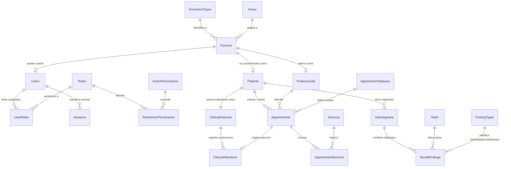
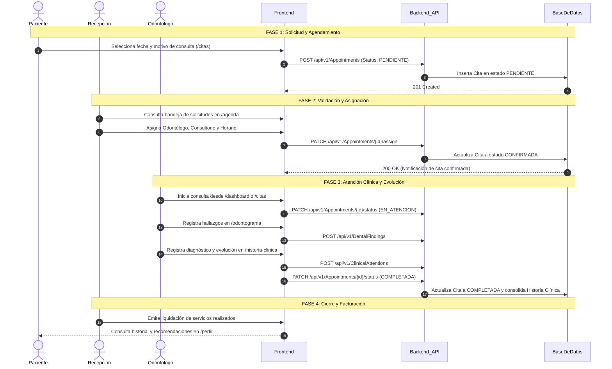

# NexusOdonto — Documento Maestro de Arquitectura, Modelo Relacional, Contratos y Flujos de Negocio

> **Versión del Documento:** 2.0.0  
> **Estado:** Producción / Referencia Técnica Oficial  
> **Alcance:** Frontend (NexusOdontoFrontend) y Backend (NexusOdontoBackend_Api)  
> **Última Actualización:** 2026-08-31

---

## Tabla de Contenidos
1. [Visión General y Arquitectura del Ecosistema](#1-visión-general-y-arquitectura-del-ecosistema)
   - 1.1 [Arquitectura del Frontend (React + TypeScript)](#11-arquitectura-del-frontend-react--typescript)
   - 1.2 [Arquitectura del Backend (.NET Clean Architecture)](#12-arquitectura-del-backend-net-clean-architecture)
   - 1.3 [Manejo de Cliente HTTP y Resiliencia en Axios](#13-manejo-de-cliente-http-y-resiliencia-en-axios)
2. [Modelo Relacional de Base de Datos (Detallado)](#2-modelo-relacional-de-base-de-datos-detallado)
   - 2.1 [Diagrama Entidad-Relación (Mermaid ERD)](#21-diagrama-entidad-relación-mermaid-erd)
   - 2.2 [Diccionario de Datos y Estructura de Tablas](#22-diccionario-de-datos-y-estructura-de-tablas)
   - 2.3 [Desglose y Justificación de Cardinalidades](#23-desglose-y-justificación-de-cardinalidades)
3. [Contratos de API, DTOs y Endpoints Completos](#3-contratos-de-api-dtos-y-endpoints-completos)
   - 3.1 [Módulo de Autenticación y Cuentas](#31-módulo-de-autenticación-y-cuentas)
   - 3.2 [Módulo de Citas y Agenda](#32-módulo-de-citas-y-agenda)
   - 3.3 [Módulo de Personas, Pacientes y Profesionales](#33-módulo-de-personas-pacientes-y-profesionales)
   - 3.4 [Módulo de Historia Clínica y Odontograma](#34-módulo-de-historia-clínica-y-odontograma)
   - 3.5 [Módulo de Catálogos, Servicios y Administración](#35-módulo-de-catálogos-servicios-y-administración)
4. [Matriz de Roles, Permisos Granulares y Accesos RBAC](#4-matriz-de-roles-permisos-granulares-y-accesos-rbac)
   - 4.1 [Definición de Roles Canónicos](#41-definición-de-roles-canónicos)
   - 4.2 [Matriz Granular de Permisos del Backend](#42-matriz-granular-de-permisos-del-backend)
   - 4.3 [Mapeo de Rutas y Menús en el Frontend](#43-mapeo-de-rutas-y-menús-en-el-frontend)
5. [Flujo de Negocio: Ciclo de Vida Integral de la Atención Odontológica](#5-flujo-de-negocio-ciclo-de-vida-integral-de-la-atención-odontológica)
   - 5.1 [Diagrama del Ciclo de Vida de la Cita](#51-diagrama-del-ciclo-de-vida-de-la-cita)
   - 5.2 [Paso a Paso Operativo entre Actores](#52-paso-a-paso-operativo-entre-actores)
6. [Asistente Virtual Inteligente (Chatbot) por Rol](#6-asistente-virtual-inteligente-chatbot-por-rol)

---

## 1. Visión General y Arquitectura del Ecosistema

NexusOdonto es un sistema empresarial desacoplado diseñado para la gestión clínica, administrativa, diagnóstica y financiera de consultorios y clínicas odontológicas.

```
┌──────────────────────────────────────────────────────────────────────────────────┐
│                      CAPA CLIENTE: FRONTEND (Single Page Application)           │
│  React 19 + TypeScript + Vite 8.x + Tailwind CSS v4 + React Router v7            │
│  • Context API (AuthContext, ThemeContext)                                       │
│  • Interceptores Axios (JWT Bearer + Control de Flujo 401/403)                  │
│  • Sistema de Guards RBAC (ProtectedRoute + routePermissions)                    │
│  • Asistente Virtual Inteligente Contextual (ChatBotWidget)                      │
└────────────────────────────────────────┬─────────────────────────────────────────┘
                                         │ HTTPS / REST JSON API
                                         ▼
┌──────────────────────────────────────────────────────────────────────────────────┐
│                   CAPA SERVIDOR: BACKEND (.NET Clean Architecture)              │
│  1. Api: Endpoints REST, Model Binding, Validaciones FluentValidation, Swagger  │
│  2. Application: Casos de Uso, DTOs, Orquestadores de Servicios, Mappers         │
│  3. Domain: Entidades, Value Objects, Enumeraciones, Reglas Invariantes          │
│  4. Infrastructure: EF Core, SQL Server, Repositorios, BCrypt, JWT Handler       │
└──────────────────────────────────────────────────────────────────────────────────┘
```

### 1.1 Arquitectura del Frontend (React + TypeScript)
El código fuente del Frontend está modularizado bajo el patrón de **Feature-Driven Development** en `src/`:

```
NexusOdontoFrontend/
├── src/
│   ├── api/                    # Clientes API y servicios desacoplados
│   │   ├── axiosClient.ts      # Instancia centralizada de Axios con interceptores
│   │   ├── authService.ts      # Endpoints públicos de login, registro y perfil
│   │   ├── personService.ts    # CRUD de personas (/v1/Persons)
│   │   ├── userService.ts      # CRUD de usuarios (/v1/Users)
│   │   ├── roleService.ts      # Catálogo de roles (/v1/Roles)
│   │   ├── documentTypeService.ts # Tipos de documento (/v1/DocumentTypes)
│   │   └── sexService.ts       # Catálogo de sexos (/v1/Sexes)
│   ├── components/             # Componentes transversales y de layout
│   │   ├── layout/
│   │   │   ├── Sidebar.tsx     # Menú lateral reactivo con filtrado estricto por rol
│   │   │   ├── PageHeader.tsx  # Barra superior con selector de tema y notificaciones
│   │   │   └── UserProfileDropdown.tsx # Menú flotante de perfil y logout
│   │   └── chatbot/
│   │       └── ChatBotWidget.tsx # Asistente virtual contextual flotante
│   ├── context/                # Estados globales (ThemeContext, etc.)
│   ├── features/               # Módulos de negocio (Vistas + Componentes locales)
│   │   ├── auth/               # LoginPage, RegisterPage, AuthContext, mocks de pruebas
│   │   ├── dashboard/          # Métricas y resúmenes ejecutivos/personales
│   │   ├── citas/              # Agendamiento, listado de citas y estados
│   │   ├── pacientes/          # Directorio de pacientes y formulario de admisión
│   │   ├── odontograma/        # Odontograma interactivo (dentición temporal y permanente)
│   │   ├── historia-clinica/   # Evoluciones clínicas, antecedentes y diagnósticos
│   │   ├── servicios/          # Catálogo de tarifas y procedimientos clínicos
│   │   ├── usuarios/           # Gestión de usuarios del personal y roles
│   │   └── perfil/             # PerfilView con capacidades diferenciadas por rol
│   ├── layouts/                # DashboardLayout que envuelve las rutas privadas
│   ├── routes/                 # AppRoutes (index.tsx) y guard ProtectedRoute.tsx
│   └── utils/                  # routePermissions.ts (Lógica de autorización RBAC)
```

### 1.2 Arquitectura del Backend (.NET Clean Architecture)
El backend implementa **Clean Architecture**, aislando estrictamente la lógica de dominio de las dependencias externas:

* **Domain:** Contiene las entidades base (`BaseEntity`), entidades de agregación (`UserEntity`, `AppointmentEntity`, `OdontogramEntity`, etc.), enumeraciones de estado y excepciones del dominio. No tiene dependencias de ningún framework.
* **Application:** Contiene los contratos (`IAuthService`, `IAppointmentService`, `IPersonService`), DTOs de entrada y salida, validadores declarativos (`FluentValidation`) y la lógica de negocio de orquestación.
* **Infrastructure:** Implementa `AppDbContext`, repositorios genéricos y especializados (`UserRepository`, `AppointmentRepository`), configuración de mapeo con Fluent API de Entity Framework Core, generador de tokens JWT y migraciones de base de datos.
* **Api:** Expone los controladores RESTful decorados con atributos de enrutamiento y seguridad (`[Authorize]`, `[AllowAnonymous]`), gestiona la inyección de dependencias en `Program.cs` y los middlewares globales de manejo de excepciones.

### 1.3 Manejo de Cliente HTTP y Resiliencia en Axios
El archivo `src/api/axiosClient.ts` implementa una política de interceptores con inteligencia de contexto:

```typescript
// Interceptor de Request: Inyecta el token Bearer si existe
axiosClient.interceptors.request.use((config) => {
  const token = localStorage.getItem('auth_token');
  if (token) {
    config.headers.Authorization = `Bearer ${token}`;
  }
  return config;
});

// Interceptor de Response: Manejo de 401 sin auto-recarga disruptiva
axiosClient.interceptors.response.use(
  (response) => response,
  (error) => {
    if (error.response && error.response.status === 401) {
      const requestUrl = error.config?.url || '';
      const isAuthEndpoint = requestUrl.includes('/auth/login') || requestUrl.includes('/auth/register');
      const currentPath = window.location.pathname;
      const isPublicRoute = currentPath === '/login' || currentPath === '/register';

      // Solo fuerza logout y redirección si el error 401 ocurre en una ruta privada
      if (!isAuthEndpoint && !isPublicRoute) {
        localStorage.removeItem('auth_token');
        localStorage.removeItem('auth_user');
        localStorage.removeItem('refresh_token');
        window.location.href = '/login';
      }
    }
    return Promise.reject(error);
  }
);
```

---

## 2. Modelo Relacional de Base de Datos (Detallado)

### 2.1 Diagrama Entidad-Relación (Mermaid ERD)



### 2.2 Diccionario de Datos y Estructura de Tablas

#### Tabla: `Persons` (Personas Físicas)
| Columna | Tipo de Dato | Nulo | Restricciones | Descripción |
| :--- | :--- | :---: | :--- | :--- |
| `Id` | `uniqueidentifier` | NO | **PK**, Default `NEWSEQUENTIALID()` | Identificador único de la persona |
| `DocumentTypeId` | `uniqueidentifier` | NO | **FK** $\rightarrow$ `DocumentTypes.Id` | Tipo de documento (CC, CE, etc.) |
| `DocumentNumber` | `nvarchar(30)` | NO | **INDEX UNIQUE** (con DocumentTypeId) | Número de identificación legal |
| `FirstName` | `nvarchar(100)` | NO | Máx 100 caracteres | Nombres de pila |
| `LastName` | `nvarchar(100)` | NO | Máx 100 caracteres | Apellidos |
| `Email` | `nvarchar(150)` | NO | **INDEX UNIQUE** | Correo electrónico de contacto |
| `Phone` | `nvarchar(25)` | SÍ | | Teléfono móvil o fijo |
| `DateOfBirth` | `datetime2` | SÍ | | Fecha de nacimiento |
| `SexId` | `uniqueidentifier` | SÍ | **FK** $\rightarrow$ `Sexes.Id` | Sexo o género |
| `Address` | `nvarchar(250)` | SÍ | | Dirección de residencia |
| `IsActive` | `bit` | NO | Default `1` | Estado lógico del registro |

#### Tabla: `Users` (Credenciales y Cuentas de Acceso)
| Columna | Tipo de Dato | Nulo | Restricciones | Descripción |
| :--- | :--- | :---: | :--- | :--- |
| `Id` | `uniqueidentifier` | NO | **PK** | Identificador único del usuario |
| `PersonId` | `uniqueidentifier` | NO | **FK** $\rightarrow$ `Persons.Id`, **UNIQUE** | Persona a la que pertenece la cuenta |
| `PasswordHash` | `nvarchar(500)` | NO | Hash BCrypt | Contraseña encriptada |
| `IsActive` | `bit` | NO | Default `1` | Cuenta habilitada / inhabilitada |
| `CreatedAtUtc` | `datetime2` | NO | Default `SYSUTCDATETIME()` | Fecha de creación del usuario |

#### Tabla: `Roles` (Catálogo de Roles)
| Columna | Tipo de Dato | Nulo | Restricciones | Descripción |
| :--- | :--- | :---: | :--- | :--- |
| `Id` | `uniqueidentifier` | NO | **PK** | Identificador único del rol |
| `Code` | `nvarchar(50)` | NO | **UNIQUE** | Código canónico (`ADMINISTRADOR`, `ODONTOLOGO`, etc.) |
| `Name` | `nvarchar(100)` | NO | | Nombre descriptivo del rol |

#### Tabla: `Appointments` (Citas Odontológicas)
| Columna | Tipo de Dato | Nulo | Restricciones | Descripción |
| :--- | :--- | :---: | :--- | :--- |
| `Id` | `uniqueidentifier` | NO | **PK** | Identificador único de la cita |
| `PatientId` | `uniqueidentifier` | NO | **FK** $\rightarrow$ `Patients.Id` | Paciente que recibe la atención |
| `ProfessionalId` | `uniqueidentifier` | SÍ | **FK** $\rightarrow$ `Professionals.Id` | Odontólogo asignado (Null si está Pendiente) |
| `AppointmentStatusId`| `uniqueidentifier` | NO | **FK** $\rightarrow$ `AppointmentStatuses.Id` | Estado (`PENDIENTE`, `CONFIRMADA`, etc.) |
| `ScheduledStart` | `datetime2` | NO | | Fecha y hora de inicio |
| `ScheduledEnd` | `datetime2` | NO | | Fecha y hora de finalización |
| `Reason` | `nvarchar(500)` | NO | | Motivo de la consulta |
| `Notes` | `nvarchar(max)` | SÍ | | Observaciones clínicas adicionales |

#### Tabla: `ClinicalHistories` y `ClinicalAttentions`
* `ClinicalHistories`: `Id` (PK), `PatientId` (FK Unique $\rightarrow$ Patients), `CreatedAtUtc`.
* `ClinicalAttentions`: `Id` (PK), `ClinicalHistoryId` (FK), `AppointmentId` (FK), `ProfessionalId` (FK), `ChiefComplaint` (Motivo), `DiagnosisCode` (CIE-10), `TreatmentPlan`, `EvolutionNotes`, `CreatedAtUtc`.

#### Tabla: `Odontograms` y `DentalFindings`
* `Odontograms`: `Id` (PK), `PatientId` (FK), `DentitionType` (Permanente/Temporal), `CreatedAtUtc`.
* `DentalFindings`: `Id` (PK), `OdontogramId` (FK), `ToothId` (FK 11..48 / 51..85), `FindingTypeId` (Caries, Corona, Ausente, Resina), `DentalSurface` (Oclusal, Mesial, Distal, Vestibular, Lingual), `State` (Existente / Requerido / Realizado).

---

### 2.3 Desglose y Justificación de Cardinalidades

1. **Relaciones 1 a 1 (1:1):**
   * **`Person` $\leftrightarrow$ `User`:** Garantiza el principio de responsabilidad única. Una persona existe físicamente aunque no tenga cuenta en el sistema (por ejemplo, pacientes menores de edad registrados por sus tutores). Si se le crea cuenta, se vincula un único `UserEntity`.
   * **`Patient` $\leftrightarrow$ `ClinicalHistory`:** Todo paciente clínico tiene un único expediente médico consolidado que recopila todo su historial vitalicio.
2. **Relaciones 1 a Muchos (1:N):**
   * **`DocumentType` $\rightarrow$ `Person`:** Un tipo de documento (e.g. Cédula) clasifica a miles de personas.
   * **`Patient` $\rightarrow$ `Appointments`:** Un paciente acumula un historial progresivo de citas a lo largo del tiempo.
   * **`Professional` $\rightarrow$ `Appointments`:** Un odontólogo tiene asignado un bloque sucesivo de citas en su jornada.
   * **`ClinicalHistory` $\rightarrow$ `ClinicalAttentions`:** Una historia clínica se compone de múltiples evoluciones y consultas sucesivas.
   * **`Odontogram` $\rightarrow$ `DentalFindings`:** Un mapa dental contiene múltiples hallazgos en distintas piezas y caras dentales.
3. **Relaciones Muchos a Muchos (N:M):**
   * **`User` $\leftrightarrow$ `Role` (`UserRoles`):** Un usuario puede tener asignados múltiples roles según sus funciones administrativas o asistenciales.
   * **`Role` $\leftrightarrow$ `ActionPermission` (`RoleActionPermissions`):** Los roles agrupan combinaciones flexibles de permisos por módulo (`VIEW`, `CREATE`, `EDIT`, `DELETE`).
   * **`Appointment` $\leftrightarrow$ `Services` (`AppointmentServices`):** En una misma cita odontológica se pueden aplicar múltiples tratamientos (e.g. Profilaxis + Resina Simple).

---

## 3. Contratos de API, DTOs y Endpoints Completos

### 3.1 Módulo de Autenticación y Cuentas

#### `POST /api/auth/login` (Público - Soporte Dual Cédula / Email)
* **Request Payload:**
```json
{
  "login": "1076543210",
  "password": "Paciente123!"
}
```
* **Response Payload (`200 OK`):**
```json
{
  "token": "eyJhbGciOiJIUzI1NiIsInR5cCI6IkpXVCJ9...",
  "refreshToken": "7c9e6679-7425-40de-944b-e07fc1f90ae7",
  "expiresAtUtc": "2026-08-31T22:00:00Z",
  "user": {
    "id": "10000000-0000-0000-0000-000000000004",
    "personId": "20000000-0000-0000-0000-000000000004",
    "name": "Andrés Pérez",
    "email": "paciente@nexusodonto.com",
    "roleIds": ["13000000-0000-0000-0000-000000000005"]
  },
  "permissions": ["APPOINTMENTS:VIEW", "PROFILE:VIEW"]
}
```

#### `POST /api/auth/register` (Público - Auto-registro de Paciente)
* **Request Payload:**
```json
{
  "documentTypeId": "e0000000-0000-0000-0000-000000000001",
  "documentNumber": "1020304050",
  "firstName": "Juan Camilo",
  "lastName": "Mendoza Riaño",
  "email": "juan.mendoza@correo.com",
  "phone": "+57 310 987 6543",
  "dateOfBirth": "1995-04-12T00:00:00Z",
  "sexId": "f0000000-0000-0000-0000-000000000002",
  "address": "Calle 45 # 12-34, Bogotá",
  "password": "Password123!",
  "roleId": "13000000-0000-0000-0000-000000000005"
}
```
* **Response Payload (`201 Created`):**
```json
{
  "id": "10000000-0000-0000-0000-000000000099",
  "personId": "20000000-0000-0000-0000-000000000099",
  "name": "Juan Camilo Mendoza Riaño",
  "email": "juan.mendoza@correo.com",
  "roleIds": ["13000000-0000-0000-0000-000000000005"]
}
```

#### `GET /api/auth/me` (Protegido `[Authorize]`)
* **Headers:** `Authorization: Bearer <token>`
* **Response Payload (`200 OK`):**
```json
{
  "user": {
    "id": "10000000-0000-0000-0000-000000000004",
    "personId": "20000000-0000-0000-0000-000000000004",
    "name": "Andrés Pérez",
    "email": "paciente@nexusodonto.com",
    "roleIds": ["13000000-0000-0000-0000-000000000005"]
  },
  "permissions": ["APPOINTMENTS:VIEW", "PROFILE:VIEW"]
}
```

---

### 3.2 Módulo de Citas y Agenda

| Método | Endpoint | Permiso Requerido | Descripción |
| :--- | :--- | :--- | :--- |
| `GET` | `/api/v1/Appointments` | `APPOINTMENTS:VIEW` | Lista general o filtrada de citas |
| `POST` | `/api/v1/Appointments` | `APPOINTMENTS:CREATE` | Creación de solicitud / agendamiento de cita |
| `PUT` | `/api/v1/Appointments/{id}` | `APPOINTMENTS:EDIT` | Actualización de horarios o notas de cita |
| `PATCH` | `/api/v1/Appointments/{id}/status` | `APPOINTMENTS:EDIT` | Transición de estado (`CONFIRMADA`, `EN_ATENCION`, etc.) |
| `PATCH` | `/api/v1/Appointments/{id}/assign` | `APPOINTMENTS:EDIT` | Asignación de profesional y sillón odontológico |
| `DELETE` | `/api/v1/Appointments/{id}` | `APPOINTMENTS:DELETE` | Cancelación definitiva de cita |

* **Payload de Creación de Cita (`POST /api/v1/Appointments`):**
```json
{
  "patientId": "30000000-0000-0000-0000-000000000001",
  "professionalId": "40000000-0000-0000-0000-000000000001",
  "scheduledStart": "2026-09-15T10:00:00Z",
  "scheduledEnd": "2026-09-15T11:00:00Z",
  "reason": "Valoración y limpieza dental general",
  "serviceIds": ["50000000-0000-0000-0000-000000000001"]
}
```

---

### 3.3 Módulo de Personas, Pacientes y Profesionales

| Método | Endpoint | Permiso | Descripción |
| :--- | :--- | :--- | :--- |
| `GET` | `/api/v1/Persons` | `PEOPLE:VIEW` | Catálogo de personas registradas |
| `POST` | `/api/v1/Persons` | `PEOPLE:CREATE` | Creación administrativa de persona física |
| `GET` | `/api/v1/Patients` | `PATIENTS:VIEW` | Directorio de pacientes clínicos |
| `POST` | `/api/v1/Patients` | `PATIENTS:CREATE` | Creación y apertura de ficha de paciente |
| `GET` | `/api/v1/Patients/{id}` | `PATIENTS:VIEW` | Consulta detallada de ficha y antecedentes |
| `GET` | `/api/v1/Professionals` | `PEOPLE:VIEW` | Directorio de odontólogos y especialistas |

---

### 3.4 Módulo de Historia Clínica y Odontograma

| Método | Endpoint | Permiso | Descripción |
| :--- | :--- | :--- | :--- |
| `GET` | `/api/v1/ClinicalHistories/patient/{patientId}` | `CLINICAL:VIEW` | Obtiene el expediente clínico del paciente |
| `POST` | `/api/v1/ClinicalAttentions` | `CLINICAL:CREATE` | Registra una nueva consulta/evolución médica |
| `GET` | `/api/v1/Odontograms/patient/{patientId}` | `ODONTOGRAM:VIEW` | Consulta el odontograma actual con hallazgos |
| `POST` | `/api/v1/DentalFindings` | `ODONTOGRAM:EDIT` | Registra patología o procedimiento en pieza dental |
| `DELETE` | `/api/v1/DentalFindings/{id}` | `ODONTOGRAM:EDIT` | Elimina o corrige un hallazgo dental previo |

* **Payload de Registro de Hallazgo Dental (`POST /api/v1/DentalFindings`):**
```json
{
  "odontogramId": "60000000-0000-0000-0000-000000000001",
  "toothNumber": 16,
  "dentalSurface": "Oclusal",
  "findingTypeCode": "CARIES",
  "state": "REQUERIDO",
  "diagnosisNotes": "Caries de segundo grado en fosa central"
}
```

---

### 3.5 Módulo de Catálogos, Servicios y Administración

| Método | Endpoint | Permiso | Descripción |
| :--- | :--- | :--- | :--- |
| `GET` | `/api/v1/DocumentTypes` | `[AllowAnonymous]` | Catálogo de tipos de documento (`CC`, `CE`, etc.) |
| `GET` | `/api/v1/Sexes` | `[AllowAnonymous]` | Catálogo de sexos/géneros |
| `GET` | `/api/v1/Services` | `CATALOGS:VIEW` | Catálogo de procedimientos y tarifas |
| `POST` | `/api/v1/Services` | `CATALOGS:CREATE` | Creación de nuevo servicio/tarifa clínica |
| `GET` | `/api/v1/Roles` | `ROLES:VIEW` | Lista de roles del sistema |
| `GET` | `/api/v1/Users` | `USERS:VIEW` | Lista administrativa de usuarios |
| `POST` | `/api/v1/Users` | `USERS:CREATE` | Creación de usuario del personal |

---

## 4. Matriz de Roles, Permisos Granulares y Accesos RBAC

### 4.1 Definición de Roles Canónicos

| Rol | GUID Oficial de Base de Datos | Alcance y Responsabilidad |
| :--- | :--- | :--- |
| **`ADMINISTRADOR`** | `13000000-0000-0000-0000-000000000001` | Control total sobre todos los módulos clínicos, configuración, personal, seguridad y auditoría. |
| **`ODONTOLOGO`** | `13000000-0000-0000-0000-000000000002` | Atención asistencial, registro de historias clínicas, evolución de odontogramas y agenda asignada. |
| **`RECEPCIONISTA`** | `13000000-0000-0000-0000-000000000003` | Admisión de pacientes, gestión de solicitudes de citas, asignación de doctores y catálogo de tarifas. |
| **`PACIENTE`** | `13000000-0000-0000-0000-000000000005` | Auto-registro, agendamiento de citas propias, consulta de historial personal y actualización de contacto. |

---

### 4.2 Matriz Granular de Permisos del Backend

| Permiso de Módulo / Acción | ADMINISTRADOR | ODONTOLOGO | RECEPCIONISTA | PACIENTE |
| :--- | :---: | :---: | :---: | :---: |
| `USERS:VIEW`, `USERS:CREATE`, `USERS:EDIT` | ✅ | ⛔ | ⛔ | ⛔ |
| `ROLES:VIEW`, `ROLES:MANAGE` | ✅ | ⛔ | ⛔ | ⛔ |
| `CATALOGS:VIEW`, `CATALOGS:CREATE` | ✅ | ⛔ | ✅ | ⛔ |
| `PEOPLE:VIEW`, `PEOPLE:CREATE` | ✅ | ⛔ | ✅ | ⛔ |
| `PATIENTS:VIEW_ALL` | ✅ | ⛔ | ✅ | ⛔ |
| `PATIENTS:VIEW_ASSIGNED` | ✅ | ✅ | ✅ | ⛔ |
| `PATIENTS:CREATE`, `PATIENTS:EDIT` | ✅ | ✅ | ✅ | ⛔ |
| `APPOINTMENTS:VIEW_ALL` | ✅ | ⛔ | ✅ | ⛔ |
| `APPOINTMENTS:VIEW_OWN` | ✅ | ✅ | ✅ | ✅ |
| `APPOINTMENTS:CREATE`, `APPOINTMENTS:EDIT` | ✅ | ✅ | ✅ | ✅ |
| `CLINICAL:VIEW`, `CLINICAL:CREATE` | ✅ | ✅ | ⛔ | ⛔ |
| `ODONTOGRAM:VIEW`, `ODONTOGRAM:EDIT` | ✅ | ✅ | ⛔ | ⛔ |
| `PROFILE:VIEW`, `PROFILE:EDIT_OWN` | ✅ | ✅ | ✅ | ✅ |

---

### 4.3 Mapeo de Rutas y Menús en el Frontend

La política de navegación gobernada por `src/utils/routePermissions.ts` y `ProtectedRoute.tsx` establece:

```
┌─────────────────────────┬─────────────────┬──────────────────┬─────────────────┬─────────────────┐
│ Ruta Frontend           │ PACIENTE        │ RECEPCIONISTA    │ ODONTOLOGO      │ ADMINISTRADOR   │
├─────────────────────────┼─────────────────┼──────────────────┼─────────────────┼─────────────────┤
│ /dashboard              │ ✅ Resumen      │ ✅ Operativo     │ ✅ Clínico      │ ✅ General      │
│ /citas                  │ ✅ Mis Citas    │ ✅ Bandeja Citas │ ✅ Citas Doc    │ ✅ Total        │
│ /agenda                 │ ⛔ Denegado     │ ✅ Agenda Global │ ✅ Mi Agenda    │ ✅ Total        │
│ /pacientes              │ ⛔ Denegado     │ ✅ Directorio    │ ✅ Mis Pacientes│ ✅ Total        │
│ /pacientes/nuevo        │ ⛔ Denegado     │ ✅ Admisión      │ ✅ Admisión     │ ✅ Total        │
│ /profesionales          │ ⛔ Denegado     │ ✅ Directorio    │ ⛔ Denegado     │ ✅ Total        │
│ /servicios              │ ⛔ Denegado     │ ✅ Tarifas       │ ⛔ Denegado     │ ✅ Total        │
│ /historia-clinica       │ ⛔ Denegado     │ ⛔ Denegado      │ ✅ Historias    │ ✅ Total        │
│ /odontograma            │ ⛔ Denegado     │ ⛔ Denegado      │ ✅ Odontograma  │ ✅ Total        │
│ /usuarios               │ ⛔ Denegado     │ ⛔ Denegado      │ ⛔ Denegado     │ ✅ Total        │
│ /roles-permisos         │ ⛔ Denegado     │ ⛔ Denegado      │ ⛔ Denegado     │ ✅ Total        │
│ /configuracion          │ ⛔ Denegado     │ ⛔ Denegado      │ ⛔ Denegado     │ ✅ Total        │
│ /perfil                 │ ✅ Contacto     │ ✅ Laboral       │ ✅ Profesional  │ ✅ Avanzado     │
└─────────────────────────┴─────────────────┴──────────────────┴─────────────────┴─────────────────┘
```

> **Aislamiento de Seguridad:** Si un usuario intenta forzar por URL el acceso a una ruta para la cual no está autorizado, el guard `ProtectedRoute` intercepta la petición, impide la renderización y muestra la tarjeta de **Acceso Restringido** con botón de redirección inmediata al `/dashboard`.

---

## 5. Flujo de Negocio: Ciclo de Vida Integral de la Atención Odontológica

### 5.1 Diagrama del Ciclo de Vida de la Cita



---

### 5.2 Paso a Paso Operativo entre Actores

1. **Auto-registro o Admisión:**
   * El paciente crea su cuenta desde `/register` (asignación automática del rol `PACIENTE`) o es admitido presencialmente en recepción desde `/pacientes/nuevo`.
2. **Solicitud de Cita:**
   * El paciente accede a **Mis Citas** (`/citas`) e ingresa el motivo de la consulta. La cita se registra con estado inicial `PENDIENTE`.
3. **Gestión de Recepción:**
   * El personal de recepción revisa la bandeja de solicitudes, verifica la disponibilidad de sillones odontológicos y doctores en `/agenda`, asigna al profesional correspondiente y cambia el estado a `CONFIRMADA`.
4. **Consulta Odontológica:**
   * El odontólogo visualiza al paciente en su lista del día. Al ingresar el paciente al consultorio, pasa la cita a `EN ATENCIÓN`.
   * El doctor utiliza el **Odontograma Interactivo** (`/odontograma`) para marcar patologías (caries, fracturas) o procedimientos requeridos (obturaciones, endodoncias, coronas).
   * Registra el motivo, diagnóstico CIE-10 y plan de tratamiento en la **Historia Clínica Electrónica** (`/historia-clinica`).
5. **Cierre de Atención y Seguimiento:**
   * La cita concluye en estado `COMPLETADA`. El paciente puede consultar desde su Dashboard y en **Mi Perfil** sus citas finalizadas y recomendaciones de higiene oral brindadas por el sistema y el asistente virtual.

---

## 6. Asistente Virtual Inteligente (Chatbot) por Rol

El componente `ChatBotWidget.tsx` implementa un canal interactivo flotante en `DashboardLayout.tsx` adaptado a las necesidades de cada usuario:

```
┌─────────────────────────────────────────────────────────────────────────────────┐
│                       CAPACIDADES DEL CHATBOT POR ROL                          │
├─────────────────┬───────────────────────────────────────────────────────────────┤
│ Rol             │ Capacidades, Sugerencias Rápidas y Contexto                   │
├─────────────────┼───────────────────────────────────────────────────────────────┤
│ PACIENTE        │ • Orientación para agendar citas odontológicas.               │
│                 │ • Consulta del estado y horario de su próxima cita médica.     │
│                 │ • Recomendaciones de cuidado e higiene bucodental.            │
│                 │ • Información sobre métodos de pago y convenios.              │
├─────────────────┼───────────────────────────────────────────────────────────────┤
│ ODONTÓLOGO      │ • Resumen rápido de pacientes citados en la jornada.          │
│                 │ • Guía de uso del Odontograma interactivo.                    │
│                 │ • Plantillas y protocolos de evolución en Historia Clínica.   │
│                 │ • Consulta de disponibilidad de agenda y sillones dentales.  │
├─────────────────┼───────────────────────────────────────────────────────────────┤
│ RECEPCIONISTA   │ • Consulta inmediata de disponibilidad de doctores.           │
│                 │ • Catálogo de procedimientos, especialidades y tarifas.       │
│                 │ • Protocolo para registrar y admitir nuevos pacientes.       │
│                 │ • Procedimiento de confirmación y cancelación de citas.       │
├─────────────────┼───────────────────────────────────────────────────────────────┤
│ ADMINISTRADOR   │ • Resumen de métricas de rendimiento y volumen de citas.      │
│                 │ • Accesos directos a la gestión de personal y roles RBAC.     │
│                 │ • Estado de seguridad, tokens activos y sesiones.             │
│                 │ • Supervisión y auditoría del ecosistema.                     │
└─────────────────┴───────────────────────────────────────────────────────────────┘
```

---

## 7. Instrucciones para Desarrolladores

### Ejecución del Frontend en Desarrollo
```bash
# Navegar al directorio del frontend
cd NexusOdontoFrontend

# Instalar dependencias
npm install

# Iniciar servidor de desarrollo en Vite
npm run dev

# Verificación de tipos TypeScript
npx tsc --noEmit

# Compilación para producción
npm run build
```

### Reglas de Contribución
1. **Separación de Responsabilidades:** No mezclar llamadas directas de `axios` en componentes; utilizar los servicios ubicados en `src/api/`.
2. **Seguridad RBAC:** Toda nueva ruta privada debe declararse en `src/utils/routePermissions.ts` dentro de `ROLE_ALLOWED_ROUTES` y validarse a través de `ProtectedRoute.tsx`.
3. **Integridad del Backend:** Toda modificación de contratos debe realizarse validando previamente los DTOs y validadores en `NexusOdontoBackend_Api/Application/DTOs`.
