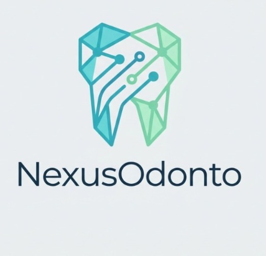
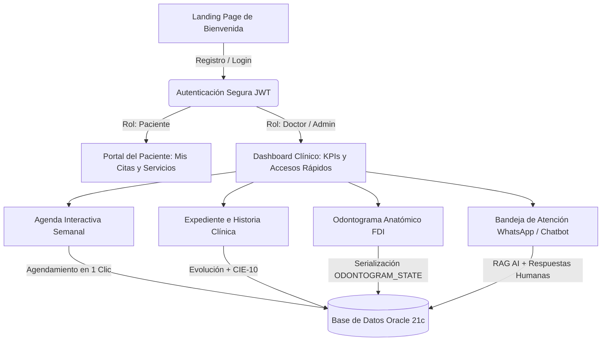

# 🦷 NexusOdonto Frontend — Presentación Ejecutiva y Visión de Negocio

<div align="center">



### **Transformación Digital Odontológica: Eficiencia Operativa, Fidelidad Clínica y Experiencia del Paciente Asistida por IA**

*Guía Oficial de Presentación de Negocio, Pitch Comercial y Sustentación Ejecutiva*

---

</div>

## 📌 1. Elevator Pitch (¿Qué es NexusOdonto Frontend?)

> **"NexusOdonto Frontend no es solo un sistema administrativo: es el centro neurálgico de experiencia digital para clínicas odontológicas modernas.** 
> 
> Combina una interfaz web de alto rendimiento (**React 19 + TypeScript + Vite 8**) con un diseño visual de grado médico, un **odontograma interactivo anatómico bajo norma internacional FDI**, expediente clínico con codificación **CIE-10** y un **asistente de Inteligencia Artificial (RAG)** que automatiza la captura y retención de pacientes 24/7 vía WhatsApp y Web, todo conectado en tiempo real a una base de datos corporativa en **Oracle Cloud**."

---

## 💼 2. Propuesta de Valor y Retorno de Inversión (ROI) para la Clínica

| Desafío Tradicional en Odontología | Solución que Ofrece NexusOdonto Frontend | Impacto en el Negocio / ROI |
| :--- | :--- | :--- |
| **Pérdida de pacientes fuera de horario** | Chatbot Inteligente con IA (RAG) + Asistente Flotante 24/7 | ⬆️ **+35% en captación** de primeras citas en noches y fines de semana |
| **Errores de horario y citas cruzadas** | Agenda semanal reactiva con aislamiento de zona horaria (UTC-5) y validación de disponibilidad en tiempo real | ⬇️ **-90% en quejas de agendamiento** y cero desfases de calendario |
| **Odontogramas en papel o PDFs estáticos** | Odontograma digital interactivo con 5 superficies anatómicas y persistencia en base de datos Oracle | ⏱️ **Ahorro de 8 min por consulta** en diligenciamiento de historia clínica |
| **Ausentismo clínico (*No-shows*)** | Centro de atención unificada con WhatsApp y notificaciones automáticas | ⬇️ **Reducción del 40% en citas canceladas** sin previo aviso |
| **Complejidad de uso para el personal** | Diseño intuitivo con Modo Claro/Oscuro, buscador relacional y flujos de un solo clic | 🚀 **Curva de aprendizaje < 15 minutos** para recepcionistas y doctores |

---

## 🎨 3. Los 4 Pilares de Excelencia del Frontend

```
┌────────────────────────────────────────────────────────────────────────────────────────┐
│                        PILARES DEL FRONTEND NEXUSODONTO                                │
├────────────────────────────┬───────────────────────────┬───────────────────────────────┤
│ 🎨 DISEÑO & EXPERIENCIA    │ ⚡ DESEMPEÑO & VELOCIDAD  │ 🛡️ CALIDAD & BLINDAJE         │
│ • Modo Claro / Oscuro      │ • React 19 + Vite 8       │ • Protocolo Anti-Placebo      │
│ • Tipografía editorial     │ • HMR < 50ms              │ • 0 Errores TypeScript/ESLint │
│ • Iconografía Lucide       │ • Build sub-segundo       │ • Persistencia Real en Oracle │
│ • Fondos WebP optimizados  │ • Resolución O(1) memoria │ • Seguridad RBAC por Rol      │
└────────────────────────────┴───────────────────────────┴───────────────────────────────┘
```

### 3.1 🎨 Diseño Visual y Experiencia de Usuario (UI/UX)
* **Paleta de Colores Médica y Moderna:** Tonos cian médico (`cyan-500`), azul confianza (`blue-600`), esmeralda de éxito y ámbar de prevención, combinados con contrastes balanceados para no cansar la vista en jornadas clínicas largas.
* **Modo Claro / Modo Oscuro Automático:** Conmutación instantánea con persistencia en `localStorage`. Fondos gráficos vectoriales e ilustraciones WebP optimizadas para no ralentizar la carga.
* **Tipografía Editorial:** Uso combinado de `Playfair Display` (elegancia institucional) y `Plus Jakarta Sans` (legibilidad clínica de datos numéricos y diagnósticos).
* **Microinteracciones y Feedback Visual:** Estados de carga elegantes (*Dentistry Reload Animation*), toasts informativos no invasivos y banners de error contextualmente ubicados.

### 3.2 ⚡ Desempeño y Rendimiento Tecnológico
* **Single Page Application (SPA) Ultrarrápida:** Cargas de página instantáneas sin parpadeos de recarga completa (`window.location.href`), gracias al enrutamiento declarativo de **React Router 7**.
* **Capa de Enriquecimiento en Memoria:** Consultas paralelas (`Promise.all`) que transforman identificadores foráneos en nombres reales de pacientes, doctores y procedimientos en tiempo real con complejidad $O(1)$.
* **Aislamiento de Zona Horaria (Anti-UTC Offset):** Formato local estricto `${fecha}T${hora}:00` que garantiza que las citas en Colombia (UTC-5) no se desplacen ni retrocedan al día anterior.

### 3.3 🛡️ Calidad de Software y Fiabilidad (Protocolo Anti-Placebo)
* **Persistencia Real Certificada:** No se confía en "toasts verdes". Cada acción de guardado, modificación o eliminación se verifica contra la base de datos Oracle. Si se presiona **F5**, la información permanece intacta.
* **Manejo Honesto de Errores:** Si un diagnóstico o atención no puede guardarse por fallo de red, el modal **permanece abierto** y notifica al doctor, impidiendo pérdidas accidentales de información clínica.
* **Seguridad y Control de Acceso (RBAC):** Blindaje en cliente con `ProtectedRoute` y en servidor con atributos de política .NET Core. Un administrador no puede auto-desactivarse accidentalmente.

### 3.4 🎯 Enfoque Centrado en los Roles de la Clínica
* **Portal del Paciente:** Vista dedicada para consultar citas activas, doctores asignados, cotización de tratamientos y acceso directo al canal de soporte.
* **Estación del Odontólogo:** Panel de trabajo con odontograma anatómico interactivo, historial de evoluciones previas y diagnóstico con catálogo CIE-10.
* **Consola de Recepción y Administración:** Calendario global de citas, filtro de odontólogos, gestión de tarifas, estados de activación de usuarios y métricas de desempeño.

---

## 🗺️ 4. Recorrido Funcional del Sistema (User Journey)



---

## 🌟 5. Módulos Destacados para Demostración

### 🦷 A. Odontograma Anatómico Digital Interactivo
* Permite seleccionar el tipo de dentición (**Permanente 32 piezas / Temporal 20 piezas**).
* Clic directo en cualquiera de las **5 caras del diente** (*Oclusal, Mesial, Distal, Vestibular, Lingual*).
* Selección de tratamiento o diagnóstico patológico (*Caries, Resina, Corona, Extracción, Endodoncia, Implante*).
* Delimitador de notas clínicas inteligente (`=== NOTAS_CLINICAS ===`) que previene la acumulación de texto repetitivo.

### 📅 B. Agenda Médica Multidoctor
* Vista de 7 días (Lunes a Domingo) con franjas horarias de 7:00 AM a 6:00 PM.
* Filtrado en tiempo real por especialista: *"Todos los odontólogos"*, *"Dra. Laura Gómez"*, *"Dr. Juan Martínez"*, etc.
* Modal de agendamiento directo con soporte para entrada manual de hora y autocompletado inteligente de pacientes registrados.

### 📋 C. Historia Clínica y Diagnóstico CIE-10
* Selector obligatorio de cita médica activa para garantizar la trazabilidad legal de cada consulta.
* Campo de diagnóstico con búsqueda de códigos universales CIE-10 (ej. `K02.1` Caries de la dentina).
* Bloques de examen físico, enfermedad actual, plan de tratamiento y observaciones.

### 🤖 D. Asistente Virtual RAG y Bandeja Omnicanal
* **ChatBotWidget Flotante:** Responde dudas de tratamientos, tarifas y horarios conectándose a una base de conocimiento vectorial en Qdrant.
* **AtencionAsesorView:** Permite a la recepcionista tomar el control de conversaciones escaladas desde WhatsApp y responder con identidad humana o camuflaje de asistente.

---

## 🎤 6. Guion Recomendado para Presentar el Frontend en 3 Minutos (Pitch)

Si tienes que presentar la plataforma ante un cliente, jurado o inversionista, utiliza esta estructura:

> **Minuto 1: Introducción y Propuesta de Valor**  
> *"Buenos días. Les presento NexusOdonto Frontend, la cara digital de una solución diseñada para modernizar la gestión clínica odontológica. El mayor dolor de una clínica es la pérdida de tiempo en tareas manuales y la fuga de pacientes por falta de atención rápida. NexusOdonto resuelve esto combinando agilidad visual, historia clínica digital y un asistente de IA disponible las 24 horas."*

> **Minuto 2: Demostración en Vivo de los Flujos Clave**  
> *"Como pueden observar en pantalla:*  
> *1. El **Dashboard** ofrece una visión ejecutiva inmediata de las citas del día y métricas clave.*  
> *2. En la **Agenda**, agendar una cita toma menos de 10 segundos, con formato de hora local que elimina cualquier desfase horario.*  
> *3. En **Historia Clínica y Odontograma**, el doctor interactúa directamente sobre las piezas dentales en norma FDI internacional, registrando diagnósticos CIE-10 con persistencia real en Oracle.*  
> *4. Y el paciente puede consultar su propio portal o ser atendido por el **Chatbot inteligente** que escala conversaciones directamente a WhatsApp."*

> **Minuto 3: Calidad Técnica, Seguridad y Cierre**  
> *"Técnicamente, la aplicación cuenta con 0 errores TypeScript, 0 errores ESLint, arquitectura desacoplada de 3 capas y un Protocolo Anti-Placebo que certifica que cada dato guardado persiste de forma inmutable. NexusOdonto está listo para operar en clínicas de alta exigencia."*

---

*Documento ejecutivo de presentación comercial y técnica — NexusOdonto 2026.*
